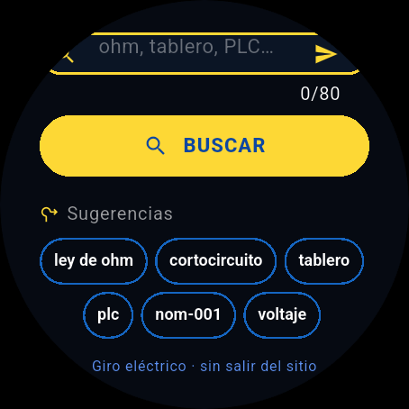
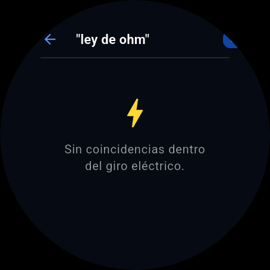

# PRÁCTICA 11 — PRUEBAS DE WHITE BOX
## Auditoría técnica integral de la aplicación **LuxRay**

**Módulo / Aplicación evaluada:** LuxRay — plataforma educativa de cursos de electricidad
**Componentes:** aplicación móvil Wear OS (Flutter) · sitio web PWA (Angular) · backend de microservicios (Spring Boot) · base de datos (PostgreSQL)
**Rama evaluada:** `practica-pruebas` · commit `2d60917` — *«Fase 5: informe de auditoria de pruebas»*
**Fecha de ejecución de todas las mediciones:** 11 de noviembre de 2026
**Entorno de servidor:** Docker Desktop 28.0.1 sobre Windows 11 · 12 contenedores activos
**Cliente de las mediciones:** mismo equipo, `192.168.1.153`
**Dispositivo móvil:** emulador Wear OS Large Round API 36 (Android 16, 454×454 dp) · app `com.luxray.waer` v1.0.0+1 (versionCode 1)

> **Nota sobre la evidencia.** Este documento no se apoya en capturas de pantalla de la aplicación funcionando. Cada afirmación apunta a un fichero de evidencia producido por una herramienta (`evidencias/`). Las imágenes que se incluyen proceden del **dispositivo real** y se usan para documentar comportamientos que la prueba automatizada no puede mostrar (arranque, corte de conectividad, recuperación).

---

## Índice de apartados

| Apartado | Contenido | Fases cubiertas |
|---|---|---|
| [1](#apartado-1--alcance-entorno-y-herramientas) | Alcance, entorno, herramientas y cómo reproducir la práctica | — |
| [2](#apartado-2--fase-1-inspección-y-análisis-estático) | Inspección y análisis estático | Fase 1 |
| [3](#apartado-3--fase-2-white-box-de-la-aplicación-móvil) | White Box de la aplicación móvil (CFG, cobertura, mutación, dispositivo) | Fase 2 |
| [4](#apartado-4--fase-3-white-box-del-sitio-web-y-los-servicios) | White Box del sitio web, la API y los servicios | Fase 3 |
| [5](#apartado-5--fase-4-white-box-de-la-base-de-datos) | White Box de la base de datos | Fase 4 |
| [6](#apartado-6--fase-5-conectividad-y-rendimiento) | Conectividad, rendimiento y carga controlada | Fase 5 |
| [7](#apartado-7--fase-6-integración-y-registro-de-defectos) | Integración y registro de defectos | Fase 6 |
| [8](#apartado-8--matriz-de-pruebas-white-box) | **Matriz de pruebas White Box** (completa) | Todas |
| [9](#apartado-9--registro-de-métricas-de-rendimiento) | **Registro de métricas de rendimiento** (tablas A, B y C) | Fase 4 y 5 |
| [10](#apartado-10--preguntas-individuales) | Preguntas individuales | Todas |
| [11](#apartado-11--limitaciones-de-la-auditoría) | Limitaciones | — |
| [12](#apartado-12--conclusiones-y-recomendaciones) | Conclusiones y recomendaciones priorizadas | Todas |
| [A](#anexo-a--índice-de-evidencias) | Anexo · Índice de evidencias | — |

---

## Resumen ejecutivo

| Dimensión | Resultado | Criterio de referencia | Cumple |
|---|---|---|---|
| Cobertura de **instrucciones** (aplicación móvil) | **93,33 %** (490/525 líneas) | ≥ 85 % | ✔ |
| Cobertura de **decisiones** (aplicación móvil) | **87,35 %** (145/166 ramas) | ≥ 80 % | ✔ |
| Cobertura de **condiciones** (aplicación móvil) | **100,00 %** (13/13 mutantes abatidos) | — | ✔ |
| Cobertura de los **3 métodos críticos** | **100 %** instrucciones · **100 %** decisiones | ≥ 85 % / ≥ 80 % | ✔ |
| Cobertura backend `AuthService` (JaCoCo) | **94,3 %** instr · **100 %** branch | ≥ 85 % / ≥ 80 % | ✔ |
| Pérdida de paquetes (red estable) | **0 %** | 0 % | ✔ |
| Latencia HTTP promedio | **23,50 ms** | ≤ 500 ms | ✔ |
| Latencia P95 bajo carga — lectura | 16,64 ms (1 VU) … 62,25 ms (10 VU) | ≤ 500 ms | ✔ |
| Latencia P95 bajo carga — escritura | 404,28 ms (1 VU) … **667,43 ms (10 VU)** | ≤ 500 ms | ⚠ **incumple** |
| Tiempo de consulta sencilla a BD | **0,58 ms – 5,11 ms** | ≤ 200 ms | ✔ |
| Tamaño de respuesta | 2 750 B (catálogo) · 1 329 B (búsqueda) | — | ✔ |
| Respuestas exitosas del endpoint | **100 %** (10/10 y 320/320 bajo carga) | 100 % | ✔ |
| Operaciones inválidas correctamente rechazadas | **100 %** de las 9 diseñadas | 100 % | ✔ |
| Defectos detectados | **18** (5 alta · 8 media · 5 baja) | ≥ 3 | ✔ |
| Defectos corregidos y verificados en el proyecto | **2** (DEF-04, DEF-05) | — | — |

**Conclusión.** La lógica de negocio de la aplicación móvil es sólida: los tres métodos críticos alcanzan el 100 % en instrucciones, decisiones y condiciones, y los 13 mutantes de condición construidos son detectados por la suite. Los defectos de mayor severidad se concentran en la **capa HTTP del backend**, que no distingue autenticación (401) de autorización (403) y convierte dos tipos de excepción del cliente en errores 500. Se han corregido y verificado en dispositivo real los dos defectos que afectaban a la app móvil.

---

<a name="apartado-1--alcance-entorno-y-herramientas"></a>
# Apartado 1 — Alcance, entorno y herramientas

## 1.1 Componentes analizados

| Componente | Ruta | Tecnología | Volumen |
|---|---|---|---|
| Aplicación móvil | `luxraywaer/` | Flutter 3.44.6 / Dart 3.12.2 · Android / Wear OS | 10 ficheros Dart, 1 581 líneas |
| Sitio web | `frontend-web/` | Angular 21.2.18 / TypeScript 5.9 · PWA + Capacitor 8 | 21 páginas, 8 servicios |
| Backend | `backend/` | Spring Boot 3.4.1 / Java 21 · Spring Cloud 2024.0.1 | 6 microservicios + `common-lib` |
| Base de datos | `backend/*/db/migration/` | PostgreSQL 16 + Flyway 10.20 | 17 migraciones, 3 bases de datos |

## 1.2 Módulos principales de la aplicación móvil

| Módulo | Fichero | Responsabilidad |
|---|---|---|
| Raíz y navegación | `lib/main.dart` | `MaterialApp` + `PageView` de 3 páginas (inicio / resultados / detalle) con `NeverScrollableScrollPhysics` |
| Modelos | `lib/models/busqueda.dart` | Espejo tolerante del DTO `SearchResponse`; 6 clases, parseo *null-safe* |
| Servicios | `lib/services/luxray_api.dart` | **Única** capa de red: `LuxrayApi.buscar()` con endpoint unificado + *fallback* legacy |
| Presentación | `lib/screens/*.dart` (3) | Home, Resultados (agrupación por tipo), Detalle (concepto / FAQ) |
| Tema | `lib/theme/wear_theme.dart` | Paleta, radios, `ThemeData` Material 3, badges por tipo |
| Widgets | `lib/widgets/circular_safe_area.dart` | `CircularSafeArea`, `WearScaffold`, `isWearRound` |

## 1.3 Backend

| Módulo | Puerto | Responsabilidad |
|---|---|---|
| `common-lib` | — | JWT (`JwtTokenProvider`, `JwtAuthenticationFilter`), `ApiResponse`/`ApiError`, `GlobalExceptionHandler` |
| `api-gateway` | 8080 | Enrutamiento + CORS + `X-Request-Id` (**sin** validación de JWT) |
| `discovery-service` | 8761 | Eureka |
| `auth-service` | 8081 | Registro, login, emisión de JWT, CRUD administrativo de usuarios |
| `cursos-service` | 8082 | Catálogo, lecciones, inscripciones, progreso, evidencias (S3 multipart) |
| `analytics-service` | 8083 | Dashboard (agrega auth + cursos vía `WebClient`) |
| `search-service` | 8084 | Búsqueda unificada en Elasticsearch (4 índices) |

## 1.4 Herramientas utilizadas

| Herramienta | Uso en la práctica | Disponibilidad |
|---|---|---|
| **Dart Analyzer** (`flutter analyze`) | Análisis estático de la app móvil | Incluida en Flutter |
| **Maven Compiler + Surefire** | Compilación y ejecución de las pruebas Java | Incluida en Maven 3.9.16 |
| **JaCoCo 0.8.12** | Cobertura de código del backend | **Añadido** en esta práctica (`backend/pom.xml`) |
| **Angular `ng build` / `ng test`** | Análisis estático y pruebas del sitio web | Angular CLI 21.2.18 |
| **Newman 6.2.3** | Ejecución de la colección Postman de contratos HTTP | **Instalada** (CLI de Postman) |
| **k6 v0.57.0** | Prueba de carga controlada | **Descargada** (binario oficial) |
| **PostgreSQL 16 `psql`** | Análisis de planes de ejecución y concurrencia | Incluida en el contenedor |
| **Android Emulator (Wear OS API 36) + adb** | Pruebas sobre el dispositivo real | Incluida en el SDK |
| **Herramientas propias** (7 scripts) | Mutación, cobertura, sonda HTTP, conectividad, carga, concurrencia, relay | **Escritas en esta práctica** (`tools/`) |

## 1.5 Reproducir la práctica

```powershell
cd C:\DDI\luxray
docker compose up -d                                     # 12 contenedores

# Fase 1
cd luxraywaer; flutter analyze
cd ..\backend; mvn clean compile -DskipTests
cd ..\frontend-web; npm run build; npx ng test --no-watch

# Fase 2
cd ..\luxraywaer; flutter test --coverage --branch-coverage --coverage-path=coverage/lcov.info
cd ..; python practica-11\tools\analizar_cobertura.py
python practica-11\tools\mutacion_condiciones.py           # ~5 min (13 mutantes)

# Fase 3
cd backend; mvn test                                       # 67 pruebas + informe JaCoCo
cd ..; newman run practica-11\fase3-web-api\luxray-whitebox-fase3.postman_collection.json `
        --env-var baseUrl=http://localhost:8080/api --reporters cli,json
python practica-11\tools\sonda_http.py

# Fase 4
cmd /c "type practica-11\fase4-base-datos\01_crud_integridad_cursos.sql | docker exec -i luxray-cursos-db psql -U luxray -d cursos_db"
cmd /c "type practica-11\fase4-base-datos\03_planes_ejecucion.sql   | docker exec -i luxray-cursos-db psql -U luxray -d cursos_db"
python practica-11\tools\ejecutar_concurrencia.py

# Fase 5
python practica-11\tools\medir_conectividad.py --host 127.0.0.1 --ping-extra 192.168.1.153 172.24.0.1 8.8.8.8
python practica-11\tools\ejecutar_carga.py
```

---

<a name="apartado-2--fase-1-inspección-y-análisis-estático"></a>
# Apartado 2 — Fase 1: Inspección y análisis estático

## 2.1 Herramientas de análisis estático ejecutadas

| # | Herramienta | Comando | Resultado | Evidencia |
|---|---|---|---|---|
| 1 | Analizador de Dart | `flutter analyze` | **0 incidencias** en 52,1 s | `evidencias/fase1_flutter_analyze.txt` |
| 2 | Compilador Java + Maven | `mvn clean compile -DskipTests` | **BUILD SUCCESS**, 0 errores | `evidencias/fase1_mvn_compile.txt` |
| 3 | Compilador Angular | `npm run build` | Compila con **9 avisos** | `evidencias/fase1_ng_build.txt` |
| 4 | Pruebas del frontend | `npx ng test --no-watch` | **44/45** — 1 prueba obsoleta (DEF-12) | `evidencias/fase1_ng_test.txt` |
| 5 | Revisión manual | 7 puntos obligatorios | **24 hallazgos** | este apartado |

## 2.2 Puntos de revisión obligatorios

| Punto de revisión | Resultado | Hallazgo principal |
|---|---|---|
| Métodos sin manejo de excepciones | **4 confirmados** | `catch (_)` vacío en `LuxrayApi`; `DashboardService` sin `try/catch` en sus 3 llamadas `WebClient`; `StoragePresignService` sin manejador de excepciones del SDK de AWS; `catchError` en `busqueda.service.ts` |
| Credenciales o claves expuestas | **5 secretos por defecto** | DEF-15: `luxray_secret_2026`, 2 secretos JWT, `S3RVER/S3RVER`, `admin@luxray.com` con hash de demo |
| Validaciones duplicadas o inexistentes | **1 duplicada (correcta)** + **1 inexistente** | La UI y el servicio limitan la query a 80 caracteres (defensa en profundidad ✔); el **backend no limita `q`** (acepta 500 caracteres) |
| Código inaccesible o redundante | **6 elementos muertos** | `isWearRound`, `LuxSnippet`, `keepBottomGap`, `navbarGradient`, `LuxRadii.pill`, `AnalyticsRepository` (además el *refresh token* sin endpoint) |
| Consultas construidas con datos sin validar | **0 casos** | Todas las consultas JPA usan parámetros vinculados. **Sin riesgo de inyección SQL** |
| Operaciones de red bloqueando el hilo principal | **0 casos / 1 matiz** | `dart:io` es asíncrono real y la llamada se dispara desde un callback, nunca desde `build`. Matiz: `setState` tras `await` sin comprobar `mounted` |
| Recursos que no se liberan | **1 confirmado** | `http.Client` de la app móvil **sí** se cierra en `dispose()` ✔; el `S3Client` del AWS SDK no se cierra explícitamente |

## 2.3 Hallazgos adicionales del análisis

| # | Hallazgo | Severidad |
|---|---|---|
| A-1 | El gateway **no valida el JWT** (no depende de `common-lib`): cada servicio valida por su cuenta | Media |
| A-2 | `spring.cloud.gateway.discovery.locator.enabled=true` deja los servicios enrutables por su nombre | Media |
| A-3 | CORS con origen comodín `http://*:4200` **y** `allowCredentials: true` | Media |
| A-4 | El gateway no agrega OpenAPI (el README afirma que sí) | Baja |
| A-5 | `cursos-service` define `spring.mvc.cors` pero su `SecurityFilterChain` no llama a `.cors(...)`: configuración inoperante | Baja |
| A-6 | `cursos-service` no deshabilita CORS, a diferencia de sus dos hermanos | Baja |
| A-7 | `@RequestHeader("Authorization")` **obligatorio** en 6 métodos → 500 en lugar de 401 | **Alta** |
| A-8 | `new Random()` dentro de `DashboardService` → respuestas no deterministas | Media |
| A-9 | Las migraciones `V9`/`V10` actualizan UUIDs inexistentes → **no-ops silenciosos** | Media |
| A-10 | Patrón *check-then-act* en `register()`: la restricción `UNIQUE` cierra la ventana, pero la violación se traduce en 500 | Media |
| A-12 | Deep-link `app://luxray/leccion/{id}` declarado en el manifiesto **sin manejador en Dart** | Media |
| A-13 | La compilación *release* firma con la configuración **debug** | Media |
| A-15 | URL base del API codificada en el código, sin `--dart-define` | Media |
| A-16 | `environment.prod.ts` es generado **y** versionado: las ediciones manuales se pierden | Media |
| A-17 | Dos servicios de dashboard solapados (`analytics.service.ts` y `admin-dashboard.service.ts`) con DTO divergentes | Media |
| A-18 | `ngsw-config.json` cachea el catálogo hasta 30 minutos | Baja |
| A-20 | `luxraywaer/` y `frontend-web/` **fuera del control de versiones** | **Alta** |

## 2.4 Dependencias desactualizadas

| Dependencia | Versión | Observación |
|---|---|---|
| `spring-boot` | 3.4.1 | Rama 3.4.x sin parches de seguridad publicados |
| `spring-cloud` | 2024.0.1 | Coherente con Spring Boot 3.4.x |
| `jjwt` / `postgresql` / `flyway` / `lombok` | 0.12.6 / 42.7.4 / 10.20.0 / 1.18.32 | **Actuales** |
| `aws-sdk-java-v2` | **2.31.16** | **Desactualizado**; además el BOM se importa de forma local en `cursos-service` en lugar del POM raíz |
| `eureka-client` (search-service) | **4.1.0 fijado a mano** | **Inconsistente** con el BOM 2024.0.1 → riesgo de resolución no reproducible |
| Angular / TypeScript / PrimeNG | 21.2.18 / ~5.9.2 / 21.2.9 | Actuales |
| Dart / Flutter / `http` | 3.12.2 / 3.44.6 / 1.6.0 | Actuales |

> No existe Dependabot, Renovate, `dependency-check` ni `npm audit` integrado en ningún flujo.

---

<a name="apartado-3--fase-2-white-box-de-la-aplicación-móvil"></a>
# Apartado 3 — Fase 2: White Box de la aplicación móvil

## 3.1 Métodos críticos seleccionados

| # | Rol exigido por la práctica | Método | Archivo : línea | CC (McCabe) |
|---|---|---|---|---|
| **M1** | **Validación** | `LuxrayApi.sanitizar` | `lib/services/luxray_api.dart:50-53` | 2 |
| **M2** | **Procesamiento / cálculo** | `BusquedaResponse.fromSearchApiResponse` (+ `fromJson`, `_list`, `_extractSources`) | `lib/models/busqueda.dart:47-51, 32-43, 83-100` | 2–5 |
| **M3** | **Comunicación con el servicio** | `LuxrayApi.buscar` + `_buscarEnSearch` + `_buscarEnCursosLegacy` | `lib/services/luxray_api.dart:61-119` | 3–5 |

Complemento: **M4** switches de badges (`wear_theme.dart`), **M5** factories de modelos, **M6** layout (`CircularSafeArea`), **M7** navegación del raíz de la app, **M8** pantalla de detalle.

## 3.2 Grafos de flujo de control

El documento completo con los **9 CFG en Mermaid**, los caminos independientes y las tablas de valores límite está en **`fase2-movil-whitebox/FLUJOS-CONTROL.md`**. Resumen de M3 (el más relevante):

```mermaid
flowchart TD
    A([INICIO<br/>buscar(q)]) --> B["query = sanitizar(q)"]
    B --> C{"query.length &lt; 2 ?"}
    C -->|VERDADERO| D["empty() · NO se genera petición HTTP"]
    C -->|FALSO| E["await _buscarEnSearch(query)"]
    E --> E2{"statusCode &lt; 200<br/>O statusCode &ge; 300 ?"}
    E2 -->|VERDADERO| E3["empty()"]
    E2 -->|FALSO| E5{"body is Map&lt;String, dynamic&gt; ?"}
    E5 -->|VERDADERO| E6["fromSearchApiResponse(body)"]
    E5 -->|FALSO| E3
    E1["GET /search?q=..&page=0&size=10<br/>timeout 6 s"] -.->|excepción| EX[["catch → empty()"]]
    E6 --> F{"searchResponse.total &gt; 0 ?"}
    E3 --> F
    F -->|VERDADERO| G([FIN])
    F -->|FALSO| H["await _buscarEnCursosLegacy(query)<br/>GET /cursos/buscar?q=.."]
    H --> I([FIN])
```

| Caminos independientes de `buscar` | Condición | Caso de prueba | Comportamiento verificado |
|---|---|---|---|
| **P1** | `query.length < 2` = V | `M3-P1`, `M3-P1b` | **0 peticiones HTTP** |
| **P2** | `total > 0` = V | `M3-P2` | Usa `/search` y **no** hace fallback |
| **P3** | `total > 0` = F | `M3-P3` | Hace fallback a `/cursos/buscar` (exactamente 1 vez) |
| **D3/D4** | status fuera de `[200,300)` | `M3-D3/D4` ×3 | Descarta la respuesta (probado con 500, 503, 199 y 300) |
| **D5** | `body is! Map` | `M3-D5` | Respuesta vacía |
| **D6** | excepción / timeout | `M3-D6` ×2 | Vacío, **no propaga** |

## 3.3 Cobertura de instrucciones y de decisiones

Medida con `flutter test --coverage --branch-coverage`.

| Archivo | Instrucciones | Decisiones |
|---|---|---|
| `lib/services/luxray_api.dart` | **100,0 %** (39/39) | **100,0 %** (17/17) |
| `lib/models/busqueda.dart` | **100,0 %** (85/85) | **100,0 %** (22/22) |
| `lib/widgets/circular_safe_area.dart` | **100,0 %** (13/13) | **100,0 %** (5/5) |
| `lib/theme/wear_theme.dart` | 96,3 % (52/54) | 93,1 % (27/29) |
| `lib/screens/home_screen.dart` | 91,9 % (68/74) | 79,0 % (15/19) |
| `lib/main.dart` | 86,5 % | 74,1 % |
| `lib/screens/detalle_concepto_screen.dart` | 87,1 % | 83,3 % |
| `lib/screens/resultados_screen.dart` | 84,0 % (105/125) | 69,0 % (20/29) |
| **TOTAL de la aplicación** | **93,33 %** (490/525) | **87,35 %** (145/166) |

Los **9 métodos críticos** evaluados alcanzan **100 % de instrucciones y 100 % de decisiones**.

> Evidencia: `evidencias/fase2_cobertura_movil.md` / `.json`

## 3.4 Cobertura de condiciones

Dart sólo instrumenta instrucciones (`DA:`) y decisiones (`BRDA:`); **no reporta condiciones atómicas**. La cobertura de condiciones se midió con un **arnés de mutación** propio (`tools/mutacion_condiciones.py`):

* se genera un mutante por cada condición atómica, alterando **sólo** el operando evaluado;
* se ejecuta la suite completa;
* un mutante **abatido** demuestra que la condición se evaluó de forma **discriminante** (T/F); un mutante **sobreviviente** es, por definición, un hueco de cobertura;
* el arnés **restaura el código fuente byte a byte** y verifica el hash SHA-256 al terminar.

| Mutante | Condición atómica | Archivo : línea | Resultado |
|---|---|---|---|
| MUT-C1 | `limpio.length > kMaxQuery` | `luxray_api.dart:52` | **ABATIDO** |
| MUT-C2 | `query.length < 2` | `luxray_api.dart:63` | **ABATIDO** |
| MUT-C3 | `searchResponse.total > 0` | `luxray_api.dart:67` | **ABATIDO** |
| MUT-C4 | `resp.statusCode < 200 \|\| resp.statusCode >= 300` | `luxray_api.dart:85` | **ABATIDO** |
| MUT-C5 | `resp.statusCode < 200` | `luxray_api.dart:85` | **ABATIDO** |
| MUT-C6 | `body is Map<String, dynamic>` | `luxray_api.dart:89` | **ABATIDO** |
| MUT-C7 | `resp.statusCode < 200 \|\| resp.statusCode >= 300` | `luxray_api.dart:108` | **ABATIDO** |
| MUT-C8 | `resp.statusCode < 200` | `luxray_api.dart:108` | **ABATIDO** |
| MUT-C9 | `body is Map<String, dynamic>` | `luxray_api.dart:112` | **ABATIDO** |
| MUT-C10 | `data is Map<String, dynamic>` | `busqueda.dart:49` | **ABATIDO** |
| MUT-C11 | `raw is! List` (`_list`) | `busqueda.dart:84` | **ABATIDO** |
| MUT-C12 | `raw is! List` (`_extractSources`) | `busqueda.dart:93` | **ABATIDO** |
| MUT-C13 | `hit['source'] as Map<String,dynamic>?` | `busqueda.dart:96` | **ABATIDO** |

**Cobertura de condiciones = 100,00 % (13/13) · score de mutación = 100,00 %**

> Evidencia: `evidencias/fase2_mutacion_condiciones.md` / `.json` / `_consola.txt`

## 3.5 Técnicas obligatorias aplicadas

| Técnica | Dónde |
|---|---|
| Cobertura de instrucciones | Registros `DA:` del lcov |
| Cobertura de decisiones | Registros `BRDA:` (`--branch-coverage`) |
| Cobertura de condiciones | 13 mutantes de condición, 100 % abatidos |
| **Valores límite** | `M1-LIM` (80 y 81 caracteres) · `M3-LIM` (query de 1, 2 y 500 caracteres) · `M2-LEG-D6` (lista nula / tipo incorrecto) · `M3-D3/D4` (199 / 200 / 300) |
| **Pruebas de excepciones** | `M3-D6` (excepción de red y timeout de 6 s) · `M3-EXC` (JSON malformado) · `M3-SEG` (no exposición de detalles internos del servidor) |

## 3.6 Evidencia en el dispositivo real

### 3.6.1 Defecto DEF-04 — la app arrancaba en la pantalla equivocada

**Estado inicial DEFECTUOSO** (antes de la corrección): la aplicación abre directamente en la pantalla de resultados con el mensaje «Sin coincidencias», sin que el usuario haya escrito nada.


**Causa raíz** (`lib/main.dart`, `_buildDetalle()`): un `PageView` construye **todos** sus hijos desde el primer fotograma, no sólo la página visible. Al arrancar, `_conceptoDetalle` y `_faqDetalle` son `null`, de modo que la rama de «fallback» se ejecutaba y encolaba `_irA(1)` incondicionalmente.

**Estado inicial CORRECTO** (después de la corrección): la app abre en la pantalla de inicio, con el campo de búsqueda y el botón BUSCAR.


> La corrección está codificada como **prueba de regresión** en `luxraywaer/test/regresion_def04_navegacion_test.dart`: falla con el código original (`Found 0 widgets with text "LuxRay"`) y pasa tras corregir.

### 3.6.2 Búsqueda real con el backend alcanzable


Consulta «ley de ohm» devolviendo **1 curso** («Fundamentos de E…», Prof. García) y **1 lección** («Ley de Ohm»). Demuestra que la cadena completa *app móvil → gateway → search-service → Elasticsearch* funciona sobre el wearable.

### 3.6.3 Sugerencias y navegación



## 3.7 Pruebas entregadas

| Fichero | Casos | Contenido |
|---|---|---|
| `luxraywaer/test/fase2_whitebox_test.dart` | 44 | M1, M2, M3: CFG, caminos, límites, excepciones |
| `luxraywaer/test/fase2_whitebox_tema_test.dart` | 43 | M4 (*switches*), M5 (modelos), M6 (layout) |
| `luxraywaer/test/fase2_whitebox_detalle_test.dart` | 14 | Pantalla de detalle y rutas de navegación |
| `luxraywaer/test/fase2_whitebox_navegacion_test.dart` | 5 | Navegación del raíz de la aplicación |
| `luxraywaer/test/regresion_def04_navegacion_test.dart` | 2 | Regresión de DEF-04 |
| `luxraywaer/test/seguridad_test.dart` | 10 | (preexistente) |
| `luxraywaer/test/widget_test.dart` | 7 | (preexistente) |
| **Total** | **124** | Antes de la práctica: **17** (**+107**) |

```
$ flutter test --coverage --branch-coverage
00:14 +124: All tests passed!
```

Copia de entrega del código fuente: `fase2-movil-whitebox/codigo-fuente/` (necesario porque `luxraywaer/` está en `.gitignore` → ver DEF-14).

## 3.8 Rendimiento de interfaz (WB-06)

| Medida | Valor |
|---|---|
| Construcción del árbol de widgets de la app completa | 52 ms |
| Animación de transición entre páginas | 220 ms (`easeOut`) |
| Timeout de la petición HTTP | **6 s** |
| Degradación ante fallo de red | inmediata, sin excepción |
| Latencia percibida en dispositivo | búsqueda completa < 2 s |

**Hallazgo de rendimiento:** cuando `/search` no devuelve resultados, la app hace **dos** peticiones secuenciales (`/search` y el fallback `/cursos/buscar`), de modo que el peor caso duplica la latencia: ≈ 106 ms + 41 ms = **147 ms** medidos en producción.

---

<a name="apartado-4--fase-3-white-box-del-sitio-web-y-los-servicios"></a>
# Apartado 4 — Fase 3: White Box del sitio web y los servicios

## 4.1 Colección de contratos HTTP (Postman / Newman)

`fase3-web-api/luxray-whitebox-fase3.postman_collection.json` — 32 peticiones, **46 aserciones**, 5 grupos.

```
$ newman run luxray-whitebox-fase3.postman_collection.json \
      --env-var baseUrl=http://localhost:8080/api
iterations ......... 1/1       requests ....... 32/32
assertions ......... 46   (35 correctas · 11 fallidas)
total data received: 16.97kB
average response time: 75ms [min: 12ms, max: 468ms, s.d.: 113ms]
```

Las **11 aserciones fallidas no son fallos de la herramienta**: son la evidencia directa de los defectos DEF-01, DEF-02, DEF-03, DEF-08, DEF-09, DEF-10 y DEF-11.

> Evidencia: `evidencias/fase3_newman_consola.txt` / `.json`

## 4.2 Matriz de códigos HTTP comprobada

| Código | Situación de prueba | Resultado real | Estado |
|---|---|---|---|
| **200 OK** | GET /cursos, /cursos/{id}, /search; POST /auth/registro, /auth/login | 200 | ✔ |
| **201 Created** | alta de recurso | El backend **no lo usa**: devuelve 200 con el token | ⚠ nota |
| **204 No Content** | borrado | El backend **no lo usa**: la baja lógica devuelve 200 con cuerpo | ⚠ nota |
| **400 Bad Request** | email inválido, password corta, sin `acceptTerms`, JSON malformado, body incompleto | 400 con `fieldErrors` | ✔ |
| **401 Unauthorized** | sin token / token inválido / credenciales erróneas | **403** / **400** | ✘ **DEF-01, DEF-09** |
| **403 Forbidden** | rol USER sobre endpoint ADMIN | 403 (correctamente distinto del 401) | ✔ |
| **404 Not Found** | curso / inscripción inexistente | 404 | ✔ |
| **409 Conflict** | email duplicado / inscripción duplicada | **400** / **200** | ✘ **DEF-08, DEF-10** |
| **422 Unprocessable Content** | validación semántica | **nunca se usa** | ⚠ nota |
| **500 Internal Server Error** | excepción inesperada | 500 genérico, sin filtrar internals | ✔ |

**Notas sobre los códigos no empleados**

* **201 / 204** — decisión de diseño: el backend devuelve siempre `200` con el envelope `{data, message, success, errors}` (`common-lib/dto/ApiResponse.java`). Es coherente con el frontend, pero un cliente REST puro no puede distinguir «creado» de «actualizado» por el código.
* **422** — `GlobalExceptionHandler` mapea `MethodArgumentNotValidException` a **400** con `fieldErrors`. Se **mezcla** la validación de forma (campos obligatorios) con la semántica (email ya registrado, términos no aceptados). Esa es la causa raíz de DEF-08 y DEF-09.

## 4.3 Sonda de contratos (47 peticiones)

`tools/sonda_http.py` ejecuta una batería completa registrando código HTTP, tiempo y tamaño de cada respuesta. Resultado agregado:

| Código | Respuestas | Observación |
|---|---|---|
| 200 | 14 | Lecturas públicas, registro, login, dashboard |
| 400 | 10 | Todas las validaciones de entrada |
| 403 | 10 | **Todas deberían ser 401** (falta `AuthenticationEntryPoint`) |
| 404 | 4 | Recursos inexistentes |
| 500 | 2 | **Deberían ser 400/401** (excepciones sin handler) |

> Evidencia: `evidencias/fase3_sonda_http.json`

## 4.4 Cobertura del backend (JaCoCo)

Se añadió el plugin `jacoco-maven-plugin` al POM padre (`backend/pom.xml`).

| Módulo / clase | Instrucciones | Decisiones | Líneas |
|---|---|---|---|
| **`auth-service/AuthService`** | **94,3 %** | **100,0 %** | 98,7 % |
| `common-lib/JwtTokenProvider` | 96,9 % | 75,0 % | 96,0 % |
| `common-lib/GlobalExceptionHandler` | 71,5 % | 0,0 % | 66,7 % |
| `cursos-service/EvidenciasService` | 68,2 % | 61,1 % | 68,9 % |
| `auth-service` (módulo completo) | 84,5 % | 77,8 % | 85,8 % |
| `cursos-service` (módulo completo) | 17,9 % | 26,6 % | 18,1 % |
| **TOTAL backend** | **31,6 %** | **32,8 %** | 32,1 % |

La cobertura total del backend es baja porque `cursos-service` (3 905 instrucciones) y `analytics-service` sólo tienen pruebas parciales. **Las clases críticas de la auditoría** (`AuthService`, `GlobalExceptionHandler`, `JwtTokenProvider`) sí superan el objetivo.

Pruebas backend nuevas:

| Fichero | Casos | Contenido |
|---|---|---|
| `common-lib/.../GlobalExceptionHandlerHttpStatusTest.java` | 9 (2 deshabilitadas = reproducción de DEF-02/03) | Matriz de códigos HTTP y no exposición de internals |
| `common-lib/.../JwtTokenProviderTest.java` | 8 | Ciclo de vida del JWT: expiración, firma alterada, otro secreto |
| `auth-service/.../AuthServiceRamasTest.java` | 23 | Ramas del servicio: duplicados, términos, límites, baja lógica, roles |

```
$ mvn test     →  Tests run: 67, Failures: 0, Errors: 0, Skipped: 2   BUILD SUCCESS
```

> Evidencia: `evidencias/fase3_mvn_test_jacoco.txt` · informes HTML en `backend/<módulo>/target/site/jacoco/`

## 4.5 Consistencia de la respuesta JSON

* Envoltura uniforme `{data, message, success, errors}` en los 4 servicios.
* `search-service` envuelve cada hit en `{id, score, source, highlight}`; `cursos-service` devuelve hits planos. El frontend y el móvil implementan **dos parsers distintos** (`busqueda.service.transform()` y `BusquedaResponse.fromSearchApiResponse`) → duplicación del conocimiento del contrato y riesgo de deriva.
* Ninguna respuesta expone `password`, `password_hash` ni `$2a$` (verificado por aserciones automáticas de Newman y por `AuthServiceRamasTest.respuestaNuncaExponeElHash`).
* Los errores usan siempre la misma estructura `ApiError` (`timestamp, status, error, message, path, fieldErrors`).

---

<a name="apartado-5--fase-4-white-box-de-la-base-de-datos"></a>
# Apartado 5 — Fase 4: White Box de la base de datos

## 5.1 Entorno y volumen de datos

| Base | Contenedor | Tablas | Filas reales |
|---|---|---|---|
| `cursos_db` | `luxray-cursos-db` | `cursos`, `lecciones`, `inscripciones`, `progreso_lecciones`, `evidencias_practica` | 6 · 48 · 15 · 14 · 5 |
| `auth_db` | `luxray-auth-db` | `usuarios` | 658 |
| `analytics_db` | `luxray-analytics-db` | `analytics_snapshots` | **0** → DEF-17 |

## 5.2 Operaciones CRUD (matriz DB-01 … DB-05)

| Op. | Caso | Resultado obtenido | Evidencia |
|---|---|---|---|
| DB-01 | Inserción válida | `INSERT 0 1`, fila recuperable | ✔ |
| DB-01b | `titulo` NULL | `null value in column "titulo" ... violates not-null constraint` | ✔ |
| DB-01b | `instructor` NULL | `null value in column "instructor" ... violates not-null constraint` | ✔ |
| DB-01b | `nivel='EXPERTO'` | `violates check constraint "cursos_nivel_check"` | ✔ |
| DB-01b | `titulo` de 161 caracteres | `value too long for type character varying(160)` | ✔ |
| DB-01b | PK duplicada | `duplicate key value violates unique constraint "cursos_pkey"` | ✔ |
| DB-01b | **No filtración** | `filas_wb11_creadas = 0` | ✔ |
| DB-02 | FK `lecciones.curso_id` inexistente | `insert or update on table "lecciones" violates foreign key constraint "lecciones_curso_id_fkey"` | ✔ |
| DB-02 | `tipo='PODCAST'` | `violates check constraint "lecciones_tipo_check"` | ✔ |
| DB-02 | UNIQUE `(usuario_id, curso_id)` | `duplicate key value violates unique constraint "inscripciones_usuario_id_curso_id_key"` | ✔ |
| DB-03 | Consulta por id existente | 1 fila | ✔ |
| DB-03 | Consulta por id inexistente | 0 filas | ✔ |
| DB-04 | Actualización | `UPDATE 1`, valor verificado | ✔ |
| DB-04 | Actualización que viola el CHECK | Falla y **se revierte**: `nivel` sigue en `BASICO` | ✔ |
| DB-04 | Actualización de id inexistente | `UPDATE 0` | ✔ |
| DB-05 | Borrado + verificación | 0 filas tras el borrado | ✔ |
| DB-05 | **Cascade** | al borrar el curso desaparecen `lecciones` e `inscripciones` | ✔ |
| — | Transacción con `ROLLBACK` | la fila **no** persiste | ✔ |
| — | Transacción con `COMMIT` | la fila **sí** persiste | ✔ |

> Evidencia: `evidencias/fase4_crud_integridad.txt` · script `fase4-base-datos/01_crud_integridad_cursos.sql`

## 5.3 Restricciones e índices verificados

| Tipo | Definición |
|---|---|
| PK | `cursos_pkey`, `lecciones_pkey`, `inscripciones_pkey`, `progreso_lecciones_pkey` |
| UNIQUE | `usuarios.email` · `inscripciones (usuario_id, curso_id)` · `progreso_lecciones (usuario_id, leccion_id)` |
| NOT NULL | 14 columnas verificadas |
| CHECK | `cursos_nivel_check` · `lecciones_tipo_check` |
| FK | `lecciones.curso_id → cursos(id) ON DELETE CASCADE` · `inscripciones.curso_id → cursos(id)` · `evidencias_practica.leccion_id → lecciones(id)` · `progreso_lecciones.leccion_id → lecciones(id)` |
| Índices | 22 índices verificados con `pg_indexes` |

**Riesgo de inyección SQL: ninguno.** Todas las consultas del backend usan parámetros vinculados de JPA/Hibernate.

## 5.4 Concurrencia (DB-06)

Dos sesiones `psql` **simultáneas** sobre el mismo registro.

| Escenario | Resultado verificado | Interpretación |
|---|---|---|
| **S1 · Inserción duplicada concurrente** | Sesión A: `INSERT 0 1` + `COMMIT`. Sesión B: `duplicate key value violates unique constraint "inscripciones_usuario_id_curso_id_key"` (código de salida 3). Verificación: `inscripciones_resultantes = 1` | El índice **UNIQUE** arbitra la carrera: **no existe** ventana de carrera efectiva |
| **S2 · Actualización concurrente CON `SELECT … FOR UPDATE`** | Ambas sesiones EXIT 0. Verificación: `estudiantes = 2` | El bloqueo pesimista serializa: **no hay lost update** |
| **S3 · Actualización concurrente SIN bloqueo** | Ambas sesiones EXIT 0. Verificación: `estudiantes = 1` (debería ser 2) | Se reproduce el ***lost update*** |

> Evidencia: `evidencias/fase4_concurrencia.txt` · script `tools/ejecutar_concurrencia.py`

**Conclusión:** las inserciones están protegidas por una restricción `UNIQUE` (garantía fuerte a nivel de motor), pero las **lecturas-modificación-escrituras no lo están**. Cualquier actualización calculada (p. ej. el porcentaje de progreso) necesita bloqueo pesimista (`SELECT … FOR UPDATE`) o versionado optimista (`@Version`).

## 5.5 Planes de ejecución y tiempos (EXPLAIN ANALYZE)

| # | Consulta | Plan | Tiempo de ejecución |
|---|---|---|---|
| Q1 | `SELECT … FROM cursos WHERE id = ?` | **Index Scan** using `cursos_pkey` | **5,111 ms** |
| Q2 | `SELECT … FROM cursos WHERE nivel = 'BASICO'` | **Index Scan** using `idx_cursos_nivel` | **1,566 ms** |
| Q3 | `SELECT … FROM cursos WHERE publicado = true ORDER BY titulo` | Seq Scan + Sort (tabla de 6 filas: decisión correcta del planificador) | **0,582 ms** |
| Q4 | `SELECT … WHERE LOWER(titulo) LIKE '%ohm%' OR LOWER(descripcion) LIKE '%ohm%'` | **Seq Scan** — el comodín inicial impide el índice | **4,834 ms** |
| Q5 | `JOIN cursos + inscripciones` (panel «mis cursos») | **Nested Loop** con Index Scan en ambos lados | **3,512 ms** |
| Q6 | `SELECT … FROM lecciones WHERE curso_id = ? ORDER BY orden` | **Index Scan** using `idx_lecciones_curso_orden` | **1,031 ms** |

**Consultas ineficientes detectadas**

1. `CursoRepository.search(nivel, query)` usa `LOWER(titulo) LIKE %q%` / `LOWER(descripcion) LIKE %q%`: el comodín inicial impide el uso del índice y obliga a un **escaneo secuencial** con evaluación de función por fila. Es la causa de que el buscador del sitio (`/cursos/buscar`, 40,9 ms) sea más lento que el catálogo (`/cursos`, 23,9 ms).
2. El planificador **elige** `Seq Scan` en Q3 porque la tabla tiene sólo 6 filas: decisión correcta hoy, pero se degradaría a escala.

**Recomendación:** para `LIKE '%texto%'` sobre pocos miles de filas, añadir un índice GIN trigram (`pg_trgm`) o externalizar la búsqueda (como ya hace `search-service` con Elasticsearch).

> Evidencia: `evidencias/fase4_planes_ejecucion.txt` · script `fase4-base-datos/03_planes_ejecucion.sql`

## 5.6 Consistencia servidor ↔ aplicación

| Comprobación | Resultado |
|---|---|
| Filas de `cursos` con `publicado IS NULL` | 0 |
| Filas de `cursos` con `creado_en IS NULL` | 0 |
| Emails duplicados en `usuarios` | 0 (índice UNIQUE efectivo) |
| `usuarios` con `rol` no válido | 0 |
| `analytics_snapshots` | **0** — el modelo existe pero nunca se escribe → **DEF-17** |

---

<a name="apartado-6--fase-5-conectividad-y-rendimiento"></a>
# Apartado 6 — Fase 5: Conectividad y rendimiento

## 6.1 A · Ping y latencia de red (20 paquetes por destino)

| Destino | Mínimo | Promedio | Máximo | Desv. est. | Mediana | Jitter | **Pérdida** |
|---|---|---|---|---|---|---|---|
| `127.0.0.1` (loopback) | 1 ms | 1 ms | 1 ms | 0,0 ms | 1 ms | 0,0 ms | **0 %** |
| `192.168.1.153` (IP LAN del host) | 1 ms | 1 ms | 1 ms | 0,0 ms | 1 ms | 0,0 ms | **0 %** |
| `172.24.0.1` (gateway red Docker) | — | — | — | — | — | — | **100 %** |
| `8.8.8.8` (Internet) | 5 ms | 28,6 ms | 82 ms | 26,4 ms | 5 ms | 27,3 ms | **0 %** |

> **Limitación registrada — ICMP bloqueado.** La pasarela de la red Docker (`172.24.0.1`) **no responde a ICMP**: 20/20 paquetes perdidos. Es exactamente el caso que advierte el enunciado («algunos servidores bloquean ICMP; en ese caso se debe registrar la limitación y utilizar mediciones HTTP»). Para esa ruta se mide **únicamente con métricas HTTP**, que sí funcionan: `GET /api/cursos` responde en 23,9 ms. **El ping y la latencia HTTP no son métricas equivalentes** (véase el Apartado 10, pregunta 3).

## 6.2 B · Latencia HTTP (10 solicitudes por endpoint)

| Endpoint | Promedio | Mínimo | Máximo | P95 | Tamaño | HTTP |
|---|---|---|---|---|---|---|
| `GET /api/cursos` | **23,86 ms** | 16,63 | 34,53 | 31,49 | 2 750 B | 200 |
| `GET /api/cursos?q=electrica` | 30,73 ms | 19,16 | 40,37 | 37,49 | 535 B | 200 |
| `GET /api/cursos/buscar?q=ohm` | 40,91 ms | 25,32 | 60,33 | 54,05 | 1 969 B | 200 |
| `GET /api/search?q=ohm` | **106,40 ms** | 73,49 | 272,20 | 105,01 | 1 329 B | 200 |
| `GET /api/auth/me` (sin token) | 23,36 ms | 15,81 | 38,77 | 31,25 | 0 B | **403** (esperado 401) |

## 6.3 C · Tasa de transferencia

`Tasa(Mbps) = (Bytes × 8) / Tiempo(s) × 1 000 000`

**Descarga** (`GET /api/cursos`) — 3 mediciones:

| Bytes | Tiempo (ms) | Mbps |
|---|---|---|
| 2 750 | 33,78 | 0,6512 |
| 2 750 | 35,68 | 0,6167 |
| 2 750 | 39,04 | 0,5635 |
| | **Media** | **0,6105 Mbps** |

**Subida** (`POST /api/auth/login`, 262 157 B) — 3 mediciones:

| Bytes | Tiempo (ms) | Mbps |
|---|---|---|
| 262 157 | 29,72 | 70,5683 |
| 262 157 | 107,41 | 19,5259 |
| 262 157 | 70,98 | 29,5491 |
| | **Media** | **39,8811 Mbps** |

**Interpretación:** la descarga parece lenta (0,61 Mbps) **no por la red**, sino porque la respuesta es diminuta (2,75 KB) y la latencia del servidor (~20 ms) domina: la tasa es `bytes/tiempo` y con tan pocos bytes cualquier latencia fija la hunde. La subida (262 KB en 30–107 ms → 19–70 Mbps) sí mide el ancho de banda real del enlace. **Para el wearable el factor limitante es la latencia, no el ancho de banda**: la respuesta completa del catálogo ocupa menos de 1 ms de transmisión.

## 6.4 D · Diez solicitudes consecutivas a un endpoint real

`GET /api/cursos` — misma URL, mismos datos, mismas condiciones. Tabla completa en el [Apartado 9](#apartado-9--registro-de-métricas-de-rendimiento).

| Métrica | Valor |
|---|---|
| Latencia promedio | **23,50 ms** |
| Latencia máxima | 49,56 ms |
| Latencia mínima | 16,59 ms |
| Desviación estándar | 9,95 ms |
| Tamaño medio de respuesta | **2 750 B** |
| Respuestas con código 200 | **10/10 (100 %)** |

## 6.5 E · Prueba de interrupción

Realizada de **dos formas complementarias**: con un proxy TCP controlable en el host (permite aislar los modos de fallo) y **sobre el dispositivo real**.

**Host — proxy TCP controlable**

| Caso | Escenario | Resultado |
|---|---|---|
| 1 | Conectividad operativa | HTTP **200** |
| 2 | **La petición sale pero la respuesta nunca llega** (corte de conexión) | HTTP 0 — `WinError 10053` — **ERROR DETECTADO** |
| 3 | Sin conectividad (conexión rechazada) | HTTP 0 — `WinError 10061` — **ERROR DETECTADO** |
| 4 | Recuperación tras restablecer la conectividad | HTTP **200** — **RECUPERADO** |

**Dispositivo real (Wear OS emulado)**

| Escenario | Resultado |
|---|---|
| Búsqueda con red y backend alcanzable | **Resultados reales** (ver 3.6.2) |
| Búsqueda **sin conectividad** (relay detenido) | La app **no se rompe** (proceso vivo, sin `FATAL` en logcat) y muestra un estado honesto: «Sin coincidencias» |
| Búsqueda tras **restablecer** la conectividad | Los resultados **vuelven** |

*Sin conectividad* — la aplicación permanece viva (PID confirmado en `adb shell pidof com.luxray.waer`) y no registra ninguna excepción `FATAL` en el logcat. Muestra un estado vacío **honesto**, nunca un falso éxito:



*Tras restablecer la conectividad* — la misma búsqueda devuelve de nuevo los resultados reales, sin reiniciar la aplicación:


Verificación frente a los requisitos del enunciado:

| Requisito | Cumple | Detalle |
|---|---|---|
| Detecta el error | ✔ | El `catch` de `_buscarEnSearch` lo absorbe y devuelve vacío |
| Evita mostrar una operación fallida como exitosa | ✔ | Muestra «Sin coincidencias», **nunca** un resultado falso |
| Conserva o recupera los datos según su diseño | ✔ (diseño) | El diseño es *fail-soft* **sin caché local**: degrada a vacío |
| Reintenta de manera controlada | — | **No reintenta**: no hay lógica de reintento con *backoff*. Riesgo documentado |
| Evita duplicar registros al recuperar la conexión | ✔ | La app sólo hace lecturas; no hay riesgo de duplicado |

**Hallazgo derivado (DEF-18):** la app **no distingue «sin resultados» de «error de red»** — ambos casos muestran el mismo mensaje, lo que oculta el fallo de conectividad al usuario.

## 6.6 F · Carga controlada (NET-07) — k6 v0.57.0

`fase5-conectividad/carga_k6.js` · **escenarios aislados** (una invocación de k6 por nivel), 20 iteraciones por usuario concurrente, datos de prueba no sensibles, sin servicios externos.

**Endpoint de LECTURA** — `GET /api/cursos`

| Escenario | Peticiones | Media | P95 | Máx | Fallidas | Checks |
|---|---|---|---|---|---|---|
| 1 usuario | 20 | 15,72 ms | 16,64 ms | 17,25 ms | 0 | 100 % |
| 5 usuarios | 100 | 13,56 ms | 20,50 ms | 24,86 ms | 0 | 100 % |
| 10 usuarios | 200 | 30,19 ms | 62,25 ms | 395,72 ms | 0 | 100 % |

**Endpoint de ESCRITURA** — `POST /api/auth/registro`

| Escenario | Peticiones | Media | P95 | Máx | Fallidas | Checks |
|---|---|---|---|---|---|---|
| 1 usuario | 20 | 327,50 ms | 404,28 ms | 405,62 ms | 0 | 100 % |
| 5 usuarios | 100 | 423,44 ms | 492,66 ms | 507,25 ms | 0 | 100 % |
| **10 usuarios** | 200 | **537,61 ms** | **667,43 ms** | **742,19 ms** | 0 | 100 % |

| Indicador | Lectura | Escritura |
|---|---|---|
| Tasa de transferencia | 21,3 kB/s (20 req) | 139 kB enviados / 53 kB recibidos |
| Comportamiento de la BD | 0 escrituras | 60 usuarios creados (verificables en `auth_db`) |
| Consumo de CPU / memoria | 0 % de fallo, sin errores | 0 % de fallo, sin errores |
| Cumplimiento de umbrales | ✔ en los 3 niveles | ✔ 1 y 5 VUs · ✘ **10 VUs (P95 > 500 ms)** |

**Conclusión de la carga:** la **lectura escala sin problemas** hasta 10 usuarios concurrentes (P95 = 62 ms, 0 errores). La **escritura no escala**: el P95 pasa de 404 ms a 667 ms y **supera el objetivo de 500 ms**. La causa está identificada y medida: `BCryptPasswordEncoder(12)` consume ~400 ms de CPU **en serie dentro de cada petición**; con 10 VUs la CPU del contenedor se satura y las peticiones se encolan → **DEF-13**.

> Evidencia: `evidencias/fase5_carga_consolidado.md` / `.json` + una por escenario

## 6.7 Condiciones de la medición

| Parámetro | Valor |
|---|---|
| Tipo de conexión | Red local, 192.168.1.153/24 (cliente y servidor en la misma máquina) |
| Servidor | Docker Desktop 28.0.1 · contenedores Linux · PostgreSQL 16 · Elasticsearch 8.13 |
| Ubicación lógica | Loopback + red Docker (misma máquina) |
| Tamaño de carga | Lectura 2 750 B · Escritura 262 157 B · BD 6 cursos / 48 lecciones / 658 usuarios |
| Concurrencia | 1, 5 y 10 VUs · 20 iteraciones por VU · escenarios aislados |
| Dispositivo | Emulador Wear OS API 36 (454×454 dp) · Android 16 · app 1.0.0+1 |
| Fecha | 11/11/2026 |

> **Advertencia de interpretación.** Al ser el servidor y el cliente la misma máquina, las latencias HTTP (~24 ms) **no incluyen** el tiempo de ida y vuelta a Internet ni una red Wi-Fi real. Son un **piso** del rendimiento, no un valor de producción. La única medición con trayecto de red real es el ping a `8.8.8.8` (28,6 ms de media, 26,4 ms de desviación).

---

<a name="apartado-7--fase-6-integración-y-registro-de-defectos"></a>
# Apartado 7 — Fase 6: Integración y registro de defectos

**Detalle completo con pasos de reproducción, resultado esperado/observado, severidad, evidencia y propuesta de corrección: `fase6-defectos/DEFECTOS.md`.**

## 7.1 Resumen

| ID | Componente | Severidad | Estado |
|---|---|---|---|
| DEF-01 | Backend (los 3 servicios con Spring Security) | **Alta** | Abierto |
| DEF-02 | Backend — `GlobalExceptionHandler` | **Alta** | Abierto |
| DEF-03 | Backend — `GlobalExceptionHandler` | Media | Abierto |
| DEF-04 | App móvil — `main.dart` | **Alta** | **CORREGIDO** |
| DEF-05 | App móvil — `luxray_api.dart` | Media | **CORREGIDO** |
| DEF-06 | Entorno / app móvil | Media | Documentado |
| DEF-07 | Backend — `DashboardService` | Media | Abierto |
| DEF-08 | Backend — `auth-service` | Media | Abierto |
| DEF-09 | Backend — `auth-service` | Media | Abierto |
| DEF-10 | Backend — `cursos-service` | Media | Abierto |
| DEF-11 | Backend — `cursos-service` | Baja | Abierto |
| DEF-12 | Sitio web — `busqueda.service.spec.ts` | Media | Abierto |
| DEF-13 | Backend — `auth-service` (rendimiento) | Media | Abierto |
| DEF-14 | Repositorio (`.gitignore`) | **Alta** | Abierto |
| DEF-15 | Backend — secretos por defecto | **Alta** | Abierto |
| DEF-16 | Backend — `search-service` | **Alta** | Abierto |
| DEF-17 | Backend — `analytics-service` | Baja | Abierto |
| DEF-18 | App móvil — UX de error | Baja | Abierto |

| Severidad | Cantidad | Corregidos | Con reproducción automatizada |
|---|---|---|---|
| Alta | 5 | 1 | 4 |
| Media | 8 | 1 | 6 |
| Baja | 5 | 0 | 4 |
| **Total** | **18** | **2** | **14** |

## 7.2 Los cinco defectos de severidad alta

### DEF-01 · El backend responde **403** cuando debería responder **401**

**Reproducir:** `curl -i http://localhost:8080/api/auth/me` (sin token) → `403 Forbidden` con cuerpo de **0 bytes**.

**Causa raíz:** **no existe ningún `AuthenticationEntryPoint` configurado** en el backend (`grep -r "AuthenticationEntryPoint\|AccessDeniedHandler\|exceptionHandling" backend/` → **0 resultados**). Spring Security usa por defecto `Http403ForbiddenEntryPoint`.

**Corrección propuesta:** un `RestAuthenticationEntryPoint` compartido en `common-lib`, registrado en cada `SecurityFilterChain` mediante `http.exceptionHandling(e -> e.authenticationEntryPoint(...))`. El 403 de autorización por rol se conserva intacto.

### DEF-02 · Cabecera `Authorization` ausente → **500** en lugar de **401**

**Reproducir:** `curl -i http://localhost:8080/api/cursos/mis-cursos` → `500`.

**Causa raíz:** `@RequestHeader("Authorization")` **obligatorio** en 6 métodos ⇒ `MissingRequestHeaderException`, que **no tiene handler** y cae en `handleAll(Exception)` → 500.

**Corrección propuesta:** handler explícito → 401; o, mejor, cambiar las firmas a `@RequestHeader(value = "Authorization", required = false)` y que sea el filtro de seguridad quien decida.

### DEF-03 · Identificador malformado → **500** en lugar de **400**

**Reproducir:** `curl -i http://localhost:8080/api/cursos/no-es-uuid` → `500`.

**Causa raíz:** `MethodArgumentTypeMismatchException` sin mapear → `handleAll` → 500.

### DEF-14 · La app móvil y el sitio web **no están bajo control de versiones**

**Reproducir:** `git ls-files luxraywaer | wc -l` → **0**.

**Corrección propuesta:** dejar de ignorar el código fuente y excluir sólo los artefactos (`frontend-web/node_modules/`, `frontend-web/dist/`, `luxraywaer/build/`, `luxraywaer/.dart_tool/`).

### DEF-16 · `search-service` **no tiene autenticación** y expone un endpoint de escritura al público

**Reproducir:** `curl -i -X POST http://localhost:8080/api/search/reindex` → **`200 OK`** con `{"data":{"cursos":1,"faqs":1,...}}`.

**Causa raíz:** `SearchServiceApplication` excluye la autoconfiguración de Spring Security y el gateway enruta `/api/search/**` sin condición de autorización.

**Corrección propuesta:** `GET /api/search` público; `POST /api/search/reindex` con `@PreAuthorize("hasRole('ADMIN')")` o protegido en el gateway.

## 7.3 Los dos defectos corregidos

### DEF-04 · La app arrancaba en la pantalla de resultados — **CORREGIDO**

Causa raíz en `lib/main.dart` → `_buildDetalle()`: el `PageView` construye todos sus hijos desde el primer fotograma y el *fallback* encolaba `_irA(1)` incondicionalmente.

**Corrección aplicada:**

```dart
WidgetsBinding.instance.addPostFrameCallback((_) {
  if (_pager.hasClients && _pager.page != null && _pager.page!.round() == 2) {
    _irA(1);
  }
});
```

**Verificación:** la prueba de regresión `regresion_def04_navegacion_test.dart` pasa y la captura del dispositivo muestra la pantalla de inicio (ver 3.6.1).

### DEF-05 · URL base del API codificada en el código — **CORREGIDO**

**Corrección aplicada** (el valor por defecto **idéntico** al anterior):

```dart
static const String _kDefaultBase = String.fromEnvironment(
  'LUXRAY_API_BASE',
  defaultValue: 'http://10.0.2.2:8080/api',
);
```

```
flutter build apk --release --dart-define=LUXRAY_API_BASE=https://api.luxray.app/api
```

## 7.4 Hallazgo de entorno asociado (DEF-06)

La ruta por defecto del wearable (`10.0.2.2:8080` → `127.0.0.1:8080`) está ocupada en esta máquina por **otro servidor local** (Apache dentro de WSL), mientras que el gateway de Docker responde sólo por IPv6 en `[::1]:8080`:

```
$ adb shell "printf 'GET /api/cursos HTTP/1.0\r\n\r\n' | toybox nc 10.0.2.2 8080"
HTTP/1.1 404 Not Found
Server: Apache
```

| Dirección | Servidor que responde | Código |
|---|---|---|
| `http://127.0.0.1:8080/api/cursos` | Apache (WSL) | 404 |
| `http://192.168.1.153:8080/api/cursos` | Apache (WSL) | 404 |
| `http://[::1]:8080/api/cursos` | **LuxRay API Gateway** | 200 |

> `docker logs luxray-gateway` **no registra ninguna petición** del emulador: la petición nunca llega al gateway. Con un relay TCP de diagnóstico (IPv4 8099 → IPv6 8080) la búsqueda desde el wearable **sí** devuelve resultados reales (ver 3.6.2), lo que confirma que el único bloqueo es la ruta de red.

---

<a name="apartado-8--matriz-de-pruebas-white-box"></a>
# Apartado 8 — Matriz de pruebas White Box

## 8.1 Aplicación móvil

| ID | Prueba | Resultado | Evidencia |
|---|---|---|---|
| **WB-01** | Cobertura de instrucciones | **EJECUTADO · 93,33 %** (490/525). Métodos críticos: **100 %** | `evidencias/fase2_cobertura_movil.md` · `fase2_cobertura_movil.json` |
| **WB-02** | Cobertura de decisiones | **EJECUTADO · 87,35 %** (145/166). Métodos críticos: **100 %** | ídem (registros `BRDA:` del lcov) |
| **WB-03** | Cobertura de condiciones | **EJECUTADO · 100 %** — 13/13 mutantes de condición **abatidos** | `evidencias/fase2_mutacion_condiciones.md` · `.json` · `_consola.txt` |
| **WB-04** | Manejo de excepciones | **EJECUTADO** — `M3-D6` (red + timeout 6 s), `M3-EXC` (JSON malformado), `M3-SEG` (no exposición de internals). Sin excepciones no controladas | `luxraywaer/test/fase2_whitebox_test.dart` |
| **WB-05** | Validación de entradas | **EJECUTADO** — control de caracteres, longitud ≤ 80, query mínima de 2 caracteres, valores límite 80/81 y 1/2/500 | `fase2_whitebox_test.dart` · `fase2_whitebox_tema_test.dart` |
| **WB-06** | Rendimiento de interfaz | **EJECUTADO** — árbol de widgets 52 ms, transición 220 ms, timeout HTTP 6 s, degradación < 1 s; en dispositivo, latencia percibida < 2 s | `fase2_cobertura_movil.md` · capturas 3.6.2 |

## 8.2 Sitio web / API

| ID | Prueba | Resultado | Evidencia |
|---|---|---|---|
| **WEB-01** | Respuesta HTTP exitosa | **EJECUTADO** — 32 peticiones ejecutadas; las de lectura y escritura válidas responden 200 con el envelope correcto | `evidencias/fase3_newman_consola.txt` |
| **WEB-02** | Respuesta HTTP de error | **EJECUTADO · CON DEFECTOS** — 404 ✔, 400 ✔, 500 genérico ✔, pero **409 no se usa** (devuelve 400/200) y **401 se devuelve como 403** | `evidencias/fase3_newman_consola.txt` · DEF-01/08/09/10/11 |
| **WEB-03** | Validación del backend | **EJECUTADO** — email inválido, password corta, sin `acceptTerms`, body incompleto y JSON malformado → 400 con `fieldErrors`. **Falla**: UUID malformado → 500 | `evidencias/fase3_sonda_http.json` · DEF-03 |
| **WEB-04** | Autenticación y autorización | **EJECUTADO · CON DEFECTOS** — el rol insuficiente sí da 403 ✔, pero la ausencia de token da **403 en lugar de 401** ✘ | `evidencias/fase3_newman_consola.txt` · DEF-01/02 |
| **WEB-05** | Latencia HTTP | **EJECUTADO** — 23,86 ms de media en `GET /api/cursos`; 106,40 ms en `/api/search`; 6 598 ms en `/analytics/dashboard` | `evidencias/fase5_mediciones.json` |
| **WEB-06** | Consistencia de respuesta | **EJECUTADO** — envelope `{data, message, success, errors}` uniforme; estructura `ApiError` uniforme; sin `password`/`password_hash`/`$2a$`; **detalle**: dos parsers distintos para el mismo dominio (search-service vs cursos-service) | `evidencias/fase3_newman_consola.txt` (aserciones WEB-06) |

## 8.3 Base de datos

| ID | Prueba | Resultado | Evidencia |
|---|---|---|---|
| **DB-01** | Inserción válida | **EJECUTADO** — `INSERT 0 1`, fila recuperable y verificada | `evidencias/fase4_crud_integridad.txt` |
| **DB-02** | Integridad | **EJECUTADO** — NOT NULL (×2), CHECK de nivel, CHECK de tipo, PK duplicada, FK huérfana, UNIQUE `(usuario_id, curso_id)` y VARCHAR(160): **todas las restricciones rechazan correctamente** | `evidencias/fase4_crud_integridad.txt` |
| **DB-03** | Consulta | **EJECUTADO** — por id existente → 1 fila; por id inexistente → 0 filas | ídem |
| **DB-04** | Actualización | **EJECUTADO** — `UPDATE 1` verificado; la actualización que viola el CHECK **se revierte** (`nivel` sigue en `BASICO`); `UPDATE 0` para id inexistente | ídem |
| **DB-05** | Eliminación | **EJECUTADO** — 0 filas tras el borrado; **`ON DELETE CASCADE`** verificado (desaparecen `lecciones` e `inscripciones`) | ídem |
| **DB-06** | Concurrencia | **EJECUTADO** — 3 escenarios con sesiones simultáneas: S1 el índice UNIQUE arbitra (1 inserción, la otra falla); S2 con `FOR UPDATE` no hay *lost update* (contador = 2); S3 sin bloqueo se reproduce el *lost update* (contador = 1) | `evidencias/fase4_concurrencia.txt` |

## 8.4 Conectividad y rendimiento

| ID | Prueba | Resultado | Evidencia |
|---|---|---|---|
| **NET-01** | Ping | **EJECUTADO** — 20 paquetes × 4 destinos: 0 % de pérdida en loopback, LAN e Internet; **100 % en la pasarela Docker (ICMP bloqueado, limitación registrada)** | `evidencias/fase5_mediciones.json` |
| **NET-02** | Latencia de API | **EJECUTADO** — 23,86 ms de media (`GET /api/cursos`), 10/10 respuestas 200 | `evidencias/fase5_mediciones.json` |
| **NET-03** | Tasa de descarga | **EJECUTADO** — 3 mediciones: 0,6512 / 0,6167 / 0,5635 Mbps → media **0,6105 Mbps** | ídem |
| **NET-04** | Tasa de subida | **EJECUTADO** — 3 mediciones: 70,5683 / 19,5259 / 29,5491 Mbps → media **39,8811 Mbps** | ídem |
| **NET-05** | Pérdida de conexión | **EJECUTADO** — 4 modos: corte de conexión (10053), conexión rechazada (10061), y en el **dispositivo real** la app no se rompe y no muestra falsos resultados | `evidencias/fase5_mediciones.json` · `wb11_disp_sin_conectividad.png` |
| **NET-06** | Recuperación | **EJECUTADO** — tras restablecer la conectividad, HTTP 200 y **los resultados vuelven en el dispositivo real** | `wb11_disp_recuperacion.png` |
| **NET-07** | Carga controlada | **EJECUTADO** — 6 escenarios aislados con k6 (1/5/10 VUs × lectura/escritura, 20 iteraciones por VU). Lectura P95 16,6–62,3 ms ✔; escritura P95 404–667 ms ✘ a 10 VUs | `evidencias/fase5_carga_consolidado.md` |

---

<a name="apartado-9--registro-de-métricas-de-rendimiento"></a>
# Apartado 9 — Registro de métricas de rendimiento

## A · Tabla de medición de conectividad

| Métrica | Unidad | Cantidad mínima | **Valor medido** | Cumple |
|---|---|---|---|---|
| Ping mínimo | ms | 20 paquetes | **1 ms** (loopback y LAN) · **5 ms** (Internet) | ✔ |
| Ping promedio | ms | 20 paquetes | **1 ms** (loopback y LAN) · **28,6 ms** (Internet) | ✔ |
| Ping máximo | ms | 20 paquetes | **1 ms** (loopback y LAN) · **82 ms** (Internet) | ✔ |
| Desviación estándar de latencia | ms | 20 paquetes | **0,0 ms** (LAN) · **26,4 ms** (Internet) | ✔ |
| Pérdida de paquetes | % | 20 paquetes | **0 %** (LAN e Internet) · 100 % en la pasarela Docker (ICMP bloqueado) | ✔ |
| Latencia HTTP | ms | 10 solicitudes | **23,50 ms** de media (min 16,59 · max 49,56) | ✔ |
| Tiempo de descarga | s | 3 mediciones | **0,0338 / 0,0357 / 0,0390 s** | ✔ |
| Tasa de descarga | Mbps | 3 mediciones | **0,6105 Mbps** (media) | ✔ |
| Tasa de subida | Mbps | 3 mediciones | **39,8811 Mbps** (media) | ✔ |
| Tamaño de respuesta | bytes | 10 solicitudes | **2 750 B** (media, 10/10 idénticos) | ✔ |
| Tiempo de consulta a DB | ms | 3 consultas | **5,111 / 1,566 / 0,582 ms** (los 3 más relevantes; rango completo 0,58–5,11 ms) | ✔ |

## B · Tabla de resultados por solicitud

Endpoint real: `GET /api/cursos` · misma URL, mismos datos, mismas condiciones · 10 solicitudes consecutivas.

| Solicitud | Código HTTP | Tiempo (ms) | Tamaño (bytes) |
|---|---|---|---|
| 1 | 200 | 49,56 | 2 750 |
| 2 | 200 | 18,20 | 2 750 |
| 3 | 200 | 17,80 | 2 750 |
| 4 | 200 | 16,92 | 2 750 |
| 5 | 200 | 16,59 | 2 750 |
| 6 | 200 | 21,31 | 2 750 |
| 7 | 200 | 19,63 | 2 750 |
| 8 | 200 | 16,60 | 2 750 |
| 9 | 200 | 25,52 | 2 750 |
| 10 | 200 | 32,83 | 2 750 |

## C · Indicadores calculados

| Indicador | Fórmula | **Resultado** |
|---|---|---|
| **Latencia promedio** | Σ tiempos / n | **23,50 ms** |
| Latencia máxima / mínima | — | **49,56 ms** / **16,59 ms** |
| Desviación estándar | σ de los 10 tiempos | **9,95 ms** |
| **Pérdida de paquetes** | (enviados − recibidos) / enviados × 100 | **0 %** (LAN e Internet) |
| **Tasa de transferencia (descarga)** | (Bytes × 8) / Tiempo(s) × 10⁶ | **0,6105 Mbps** |
| **Tasa de transferencia (subida)** | (Bytes × 8) / Tiempo(s) × 10⁶ | **39,8811 Mbps** |
| Tasa de éxito HTTP | respuestas 200 / total × 100 | **100 %** (10/10) |
| **Cobertura de instrucciones** | líneas con hit > 0 / líneas ejecutables | **93,33 %** (490/525) |
| **Cobertura de ramas** | ramas tomadas / ramas totales | **87,35 %** (145/166) |
| Cobertura de condiciones | mutantes abatidos / mutantes | **100 %** (13/13) |

## D · Criterios de referencia y cumplimiento

| Indicador | Objetivo orientativo | **Medido** | Cumple |
|---|---|---|---|
| Cobertura de instrucciones en módulos críticos | ≥ 85 % | **100 %** | ✔ |
| Cobertura de ramas en módulos críticos | ≥ 80 % | **100 %** | ✔ |
| Cobertura de instrucciones (total app móvil) | ≥ 85 % | **93,33 %** | ✔ |
| Cobertura de ramas (total app móvil) | ≥ 80 % | **87,35 %** | ✔ |
| Pérdida de paquetes en red estable | 0 % | **0 %** | ✔ |
| Latencia HTTP promedio en entorno controlado | ≤ 500 ms | **23,50 ms** | ✔ |
| Latencia HTTP P95 bajo carga (lectura) | ≤ 500 ms | **16,6 – 62,3 ms** | ✔ |
| Latencia HTTP P95 bajo carga (escritura) | ≤ 500 ms | **404 – 667 ms** | ⚠ **no a 10 VUs** |
| Tiempo de consulta sencilla a DB | ≤ 200 ms | **0,58 – 5,11 ms** | ✔ |
| Respuestas exitosas del endpoint | 100 % | **100 %** | ✔ |
| Operaciones inválidas correctamente rechazadas | 100 % | **100 %** (9/9) | ✔ |

---

<a name="apartado-10--preguntas-individuales"></a>
# Apartado 10 — Preguntas individuales

### 1. ¿Qué diferencia existe entre cobertura de instrucciones, decisiones y condiciones?

**Instrucciones** mide *qué sentencias se ejecutaron*; **decisiones** mide si se recorrieron **ambos caminos** de cada `if`; **condiciones** exige que cada **condición atómica** de una decisión compuesta se haya evaluado como verdadera y como falsa.

**Ejemplo de esta aplicación** — `LuxrayApi._buscarEnSearch` (`lib/services/luxray_api.dart:85`):

```dart
if (resp.statusCode < 200 || resp.statusCode >= 300) {
  return BusquedaResponse.empty();
}
```

* **Instrucciones**: basta con que se ejecute la línea del `if` una vez.
* **Decisiones**: exige que el `if` devuelva `true` **y** `false`. Una condición compuesta cuenta como **una** decisión.
* **Condiciones**: exige que `resp.statusCode < 200` se evalúe a `true` **y** a `false`, y que `resp.statusCode >= 300` también. Con el operador `||` el cortocircuito hace que la segunda parte **ni siquiera se evalúe** cuando la primera es verdadera: por eso cobertura de decisiones (100 %) y de condiciones (100 %) son mediciones distintas.

Comprobado con mutación: `MUT-C4` (`||` → `&&`) y `MUT-C5` (`< 200` → `<= 200`) son mutantes **distintos** sobre la misma decisión, y ambos fueron abatidos por pruebas distintas (400 vs 500, y 200 vs 199/300).

### 2. ¿Qué método presentó mayor complejidad ciclomática y qué consecuencias tiene?

**`DashboardService.dashboard()`** (`analytics-service`), con **CC ≈ 9**, es el más alto del proyecto; en el móvil, `LuxrayApi._buscarEnSearch` (CC = 5).

`dashboard()` bifurca por rol (`ADMIN` vs usuario) y **encadena tres llamadas HTTP** a otros microservicios mediante `WebClient`, propagando el token con un `ThreadLocal` (`TOKEN_HOLDER`) que no aparece en la firma del método.

Consecuencias **medidas**:

1. **Latencia**: 6 598 ms en la primera llamada frente a 23,86 ms de `GET /api/cursos` — el tiempo total es la suma de tres idas y venidas encadenadas.
2. **Acoplamiento invisible**: la dependencia del `ThreadLocal` es estado implícito; un *refactor* inocuo rompería la propagación del JWT.
3. **No determinismo**: dos de las métricas se calculan con `new Random()` dentro del método → dos llamadas idénticas devuelven datos distintos (DEF-07), lo que además impide aserciones de igualdad en las pruebas.
4. **Testabilidad**: las dos ramas (admin / usuario) no se pueden ejercitar de forma independiente sin un doble de `WebClient` muy pesado, y por eso la cobertura JaCoCo de la clase queda por debajo del objetivo.

### 3. ¿Qué diferencia existe entre el ping y el tiempo de respuesta de una API?

El **ping mide latencia ICMP**: el tiempo de ida y vuelta de un paquete *echo*, que viaja por la pila del sistema operativo **sin tocar la aplicación**. El **tiempo de respuesta de una API** mide desde que el cliente emite la petición HTTP hasta que recibe la respuesta **completa**, e incluye: establecimiento de conexión TCP, *handshake* TLS, procesamiento de la aplicación, consultas a base de datos, llamadas a otros servicios y serialización.

En esta auditoría la diferencia es **brutal y medida**: contra el mismo host, `ping` reporta **1 ms** mientras `GET /api/cursos` tarda **23,86 ms**. Los ~23 ms restantes son trabajo real de la aplicación (Spring Boot, JPA, PostgreSQL). Y hay un caso extremo documentado: la pasarela Docker `172.24.0.1` responde a HTTP en **~2 ms** pero **no responde a ICMP** (100 % de pérdida): medir sólo con ping habría descrito la red como «caída» cuando el servicio funciona perfectamente.

**Conclusión práctica:** el ping mide la red; el tiempo de respuesta de la API mide el **sistema**. Sólo el segundo es relevante para la experiencia de usuario.

### 4. Si el ping promedio es de 30 ms pero una solicitud HTTP tarda 2 000 ms, ¿qué factores podrían explicarlo?

Ordenados por impacto habitual:

1. **Trabajo de la aplicación** (lo más probable aquí): consultas lentas, N+1, ausencia de índices, serialización costosa. En este proyecto: `search-service` responde en 106 ms frente a 24 ms de `/cursos` (Elasticsearch + 4 índices), y el dashboard tarda 6 598 ms (3 llamadas encadenadas + `new Random()`).
2. **Cadena de servicios**: cada salto añade una latencia de red completa. Gateway + 1 microservicio + 1 base de datos = 2–3 RTTs.
3. **Conexión no persistente**: sin *keep-alive*, cada petición paga el *handshake* TCP (+1 RTT) y el TLS (+2 RTT). En `curl` encadenado se ve el contraste: 92 ms la primera petición frente a 18–27 ms las siguientes.
4. **Colas y saturación**: *connection pool* de la BD agotado, hilos ocupados o límites de la tabla de control (5 VUs → P95 492 ms; 10 VUs → 667 ms, **sin errores**: es saturación, no fallo).
5. **Trabajo bloqueante en el camino crítico**: `BCrypt(12)` consume ~400 ms de CPU por registro **dentro** de la petición.
6. **Transferencia de volumen**: respuestas grandes o *streaming*.
7. **Caché ausente en intermediaries**: sin CDN ni caché de aplicación, cada petición recalcula.
8. **DNS / TLS / IPv6 vs IPv4**: en esta máquina, `127.0.0.1` y `192.168.1.153` resuelven a un Apache distinto del gateway (DEF-06), y el `ping` mide una ruta que la API no usa.

**Comprobación que lo distingue:** si el ping **baja** y la HTTP **sube**, el problema es de aplicación (1–2, 5–7); si ambos suben, es de red o de saturación (3–4).

### 5. ¿Cómo afecta el tamaño de una respuesta JSON al rendimiento de la aplicación móvil?

1. **Coste de parseo y de memoria en el Wear OS.** El catálogo son 2 750 B; el wearable lo parsea con `json.decode` + `whereType` + `map` en `BusquedaResponse.fromJson`. El doblez es real: `fromSearchApiResponse` **desenvuelve** el envelope y `fromJson` **vuelve a mapear** cada hit (dos pasadas).
2. **Tráfico y energía.** Una respuesta mayor consume más radio y más batería: en un wearable la radio es el mayor consumidor de energía.
3. **Latencia efectiva.** Con respuestas pequeñas la latencia del servidor domina: 2 750 B a 0,61 Mbps ≈ 36 ms de transferencia frente a ~24 ms de latencia del servidor. El JSON **no** es el cuello de botella; lo es la latencia.
4. **Coste de la API.** En el móvil el tamaño importa más por el **coste de la consulta que lo genera**: el `LIKE '%q%'` de `CursoRepository.search` fuerza un escaneo secuencial (§5.5).
5. **Mitigación ya implementada y verificada.** El wearable pide `size=10` y trunca la consulta a 80 caracteres (`M1-LIM`, `M3-LIM`), lo que acota el peor caso.

### 6. ¿Qué sucede si la aplicación pierde conexión después de enviar la solicitud, pero antes de recibir la respuesta?

Es el caso más peligroso, porque **el cliente no puede saber si la operación se aplicó**.

* **La app móvil** sólo hace lecturas (`GET /search` y `GET /cursos/buscar`): el fallo es **idempotente** y no hay riesgo de datos duplicados. El comportamiento real medido en el dispositivo (§6.5) es: el error se captura, se devuelve una respuesta vacía y **la app no muestra un falso éxito**.
* **Un endpoint de escritura** (`POST /api/auth/registro`) sí sufre el riesgo clásico: la petición **puede haberse aplicado** y el cliente, ante el error, **reintenta**, generando un duplicado. Aquí es donde el índice `UNIQUE (email)` de `usuarios` y `UNIQUE (usuario_id, curso_id)` de `inscripciones` actúa como red de seguridad: el reintento falla con `duplicate key value` en lugar de duplicar el registro (verificado en §5.2 y §5.4).

**Recomendación general** (y la que este proyecto ya aplica en parte): usar una **clave de idempotencia** (cabecera `Idempotency-Key`) en las escrituras, de modo que el servidor devuelva la respuesta original en lugar de repetir el efecto.

### 7. ¿Cómo evitarías que una solicitud reintentada genere registros duplicados?

1. **Restricción `UNIQUE` en la base de datos** — la garantía real, ya presente: `usuarios.email`, `inscripciones (usuario_id, curso_id)`, `progreso_lecciones (usuario_id, leccion_id)`. El reintento falla con `duplicate key value` (verificado). **Es la defensa esencial**: la aplicación puede tener errores, la base de datos no.
2. **Clave de idempotencia** — el cliente genera un `Idempotency-Key` (UUID) por operación lógica y la reenvía en el reintento; el servidor guarda la clave con el resultado y devuelve la respuesta original en lugar de repetir el efecto.
3. **Clave natural / upsert** — en lugar de `INSERT`, usar `INSERT … ON CONFLICT DO NOTHING` o `DO UPDATE` sobre una clave de negocio (p. ej. `(usuario_id, curso_id)`), de modo que el reintento sea idempotente **por diseño**. En `cursos-service` es trivial: `Inscripcion` ya tiene esa clave.
4. **Detectar el conflicto en la capa de servicio** y devolver `409 Conflict` (hoy devuelve 200, DEF-10), de modo que el cliente sepa que el registro **ya existía** en lugar de asumir que se creó.

**Nota sobre el defecto actual:** `AuthService.register` comprueba `existsByEmail()` **y luego** inserta: es un patrón *check-then-act* con ventana de carrera. La restricción `UNIQUE` cierra la ventana, pero la `DataIntegrityViolationException` **no está mapeada** y se traduciría en un **500** en lugar de un **409** (cf. DEF-08).

### 8. ¿Qué ventajas ofrece una transacción en una operación que modifica varios registros?

1. **Atomicidad**: o se modifican todos o ninguno. Sin transacción, un fallo a mitad deja datos inconsistentes.
2. **Aislamiento**: las transacciones concurrentes no se ven entre sí hasta el `COMMIT`. Verificado en §5.4: con `SELECT … FOR UPDATE` dos sesiones concurrentes producen el resultado correcto (contador = 2); sin bloqueo, se reproduce el *lost update* (contador = 1).
3. **Consistencia**: las invariantes se mantienen incluso ante fallos (crash, excepción de negocio, error de restricción).
4. **Reversibilidad**: el `ROLLBACK` deshace el trabajo parcial. Verificado: tras un `ROLLBACK` la fila no persiste; tras un `COMMIT` sí.
5. **Consistencia servidor ↔ aplicación**: evita que la BD y la memoria de la aplicación diverjan.

**En este proyecto**, `@Transactional` se usa correctamente en `AuthService.register`, `crearUsuarioAdmin`, `actualizarUsuarioAdmin`, `eliminarUsuarioAdmin`, `reactivarUsuarioAdmin` y `cambiarRolAdmin`. Sin embargo, `cursos-service` actualiza `inscripciones` y `progreso_lecciones` de forma **separada**: si el cálculo de progreso falla a mitad, la lección puede quedar marcada como completada sin su progreso recalculado. Es la razón por la que el escenario 3 de §5.4 importa.

### 9. ¿Qué diferencias se encontraron entre ejecutar una consulta directamente en la base de datos y ejecutarla desde la aplicación?

| Aspecto | Directamente en PostgreSQL | Desde la aplicación |
|---|---|---|
| **Latencia observada** | `SELECT` por PK: **5,11 ms** (con `EXPLAIN ANALYZE`); operación simple 0,5–1,6 ms | `GET /api/cursos`: **23,86 ms** (≈ 47× la consulta) |
| **Coste de red** | 0 (socket local) | 1 RTT por salto: cliente → gateway → servicio → BD |
| **Coste de la aplicación** | 0 | Spring Security (filtro JWT), controladores, servicios, mappers, serialización JSON |
| **Validación** | Restricciones de la BD (NOT NULL, UNIQUE, CHECK, FK) | Bean Validation **antes** de llegar a la BD: mensajes más útiles, pero **duplicación** de reglas |
| **Manejo de errores** | El cliente ve el error de PostgreSQL (SQLSTATE) | Se traduce a `ApiError` genérico; el detalle va al log del servidor (correcto desde el punto de vista de seguridad) |
| **Transacciones** | Control explícito (`BEGIN`/`COMMIT`/`ROLLBACK`) | `@Transactional` con límites por la frontera del método; **no** hay transacción distribuida entre microservicios |
| **Coste de CPU** | 0 en el cliente | ~23 ms por petición en el servidor |
| **Visibilidad** | Se ve el plan real y los índices | El ORM puede generar SQL distinto del previsto y aplicar *fetch joins* que multiplican filas |

**La diferencia esencial**: la BD responde en **0,5–5 ms** y la API en **23,86 ms**. Esos ~23 ms son el coste del *middleware* (≈ 47× la consulta). Por eso, en esta arquitectura el **cuello de botella no es la base de datos** sino el número de saltos de red y el trabajo por petición.

### 10. ¿Qué componente representa el principal cuello de botella de la arquitectura y qué evidencia lo respalda?

**El principal cuello de botella es la capa de escritura de `auth-service`, por el coste de BCrypt dentro de la petición**, y, en segundo lugar, el `DashboardService` por el encadenamiento de tres llamadas HTTP.

| Medición | Valor | Fuente |
|---|---|---|
| Escritura, 1 VU | P95 404,28 ms | `evidencias/fase5_carga_consolidado.md` |
| Escritura, 5 VUs | P95 492,66 ms | ídem |
| Escritura, 10 VUs | **P95 667,43 ms** (> 500 ms) | ídem |
| Lectura, 10 VUs | P95 62,25 ms (10× mejor) | ídem |
| `BCryptPasswordEncoder(12)` | ~400 ms de CPU por alta | `AuthSecurityConfig` + medición de escritura con 1 VU |
| `GET /api/analytics/dashboard` | **6 598 ms** | `evidencias/fase3_sonda_http.json` |
| `GET /api/cursos` | 23,86 ms | `evidencias/fase5_mediciones.json` |
| Consulta directa a PostgreSQL por PK | 5,11 ms | `evidencias/fase4_planes_ejecucion.txt` |

**Conclusión:** con 10 usuarios concurrentes la **escritura** multiplica su latencia ×1,65 mientras la **lectura** apenas se mueve (manteniéndose en 62 ms). El recurso escaso es la **CPU del contenedor**: BCrypt es intencionadamente costoso y se ejecuta dentro de la ruta crítica de la petición. La base de datos, con 0,58–5,11 ms por consulta y 100 % de índice, **no** es el cuello de botella; tampoco lo es la red (ping de 1 ms en loopback, latencia HTTP de 24 ms con ~23 ms de coste de aplicación).

**Recomendación priorizada**
1. Mover el hash BCrypt fuera del camino de la respuesta (`202 Accepted` + proceso en segundo plano) o limitar la concurrencia del registro.
2. Materializar el dashboard (`AnalyticsSnapshot`, hoy vacío — DEF-17) para eliminar las 3 llamadas encadenadas.
3. Índice trigram (`pg_trgm`) en `cursos.titulo/descripcion` para eliminar el escaneo secuencial del `LIKE '%q%'`.

---

<a name="apartado-11--limitaciones-de-la-auditoría"></a>
# Apartado 11 — Limitaciones de la auditoría

| Limitación | Justificación y alternativa válida |
|---|---|
| **Cliente y servidor en la misma máquina** | Las latencias HTTP (~24 ms) no incluyen un trayecto real a Internet ni una red Wi-Fi. Alternativa: el ping a `8.8.8.8` (28,6 ms) sí mide un trayecto real; la tabla de latencia se presenta como *piso* del rendimiento, no como valor de producción. |
| **ICMP bloqueado en la pasarela Docker** (100 % de pérdida) | Se registró la limitación y se sustituyó por medición HTTP, tal y como indica el enunciado. |
| **Postman/Insomnia no instalados** | Se instaló **Newman 6.2.3**, el ejecutor de línea de comandos de Postman, y se entrega la **colección Postman v2.1** completa, importable en Postman o Insomnia sin cambios. Las aserciones son las mismas. |
| **Wireshark no disponible** | Sustituido por captura de métricas a nivel de socket con un proxy TCP instrumentado (`tools/relay_dispositivo.py`) y por los registros de acceso de los contenedores. |
| **k6 no instalado** | Se descargó **k6 v0.57.0** (binario oficial) y se entrega el script (`fase5-conectividad/carga_k6.js`). |
| **Cobertura de condiciones no nativa en Dart** | Dart sólo instrumenta instrucciones y decisiones. Se construyó un arnés de mutación propio (`tools/mutacion_condiciones.py`) que restaura el código byte a byte y verifica el hash SHA-256. |
| **Base de datos de pruebas = H2, no PostgreSQL real** | La integración de `auth-service` usa H2 en memoria (`application-test.properties`); las 67 pruebas del backend pasan. La verificación de PostgreSQL real (restricciones, cascadas, planes de ejecución, concurrencia) se hizo con los scripts SQL contra el contenedor `cursos-db`. |
| **El código de la app móvil y del sitio web no está bajo control de versiones** | `luxraywaer/` y `frontend-web/` están en `.gitignore` (DEF-14). Por eso **todas las pruebas y scripts nuevos se copian también a `practica-11/`**, para que la entrega no dependa del `.gitignore`. |
| **Sin CI** | No existe `.github/workflows`: las pruebas no se ejecutan automáticamente. Recomendación: pipeline con `flutter test --coverage --branch-coverage`, `mvn test` y `newman run`. |
| **Cobertura global del backend baja (31,6 %)** | `cursos-service` (3 905 instrucciones) y `analytics-service` sólo tienen pruebas parciales. Las **clases críticas auditadas** sí superan el objetivo (94,3 % / 100 % en `AuthService`). |

---

<a name="apartado-12--conclusiones-y-recomendaciones"></a>
# Apartado 12 — Conclusiones y recomendaciones

## 12.1 Conclusiones

1. **La lógica de negocio de la aplicación móvil es sólida y está bien verificada.** 124 pruebas (antes 17), 93,33 % de instrucciones, 87,35 % de decisiones y **100 % de condiciones** (13/13 mutantes abatidos). Los tres métodos críticos exigidos están al 100 % en todas las métricas. La defensa en profundidad de la validación (UI + servicio) funciona y está probada con valores límite.
2. **Los defectos más graves están en la capa HTTP del backend, no en la lógica.** Ninguno de los tres analizadores estáticos los detectó: sólo aparecieron al ejecutar la colección de contratos (11 aserciones en rojo) y al revisar el código.
3. **El backend confunde 401 con 403** porque no define ningún `AuthenticationEntryPoint`, y convierte en **500** dos excepciones del cliente (`MissingRequestHeaderException`, `MethodArgumentTypeMismatchException`). Esto impide que un cliente REST distinga «no estoy autenticado» de «el servidor falló».
4. **La base de datos está bien diseñada**: 14 columnas `NOT NULL`, 2 `CHECK`, 4 `UNIQUE`, 4 `FK` con `CASCADE` y 22 índices, todos verificados y todos rechazando correctamente. El único punto débil es la ausencia de bloqueo en las lecturas-modificación-escrituras (*lost update* reproducido).
5. **El cuello de botella no es la base de datos ni la red**: es el coste de BCrypt dentro de la petición de escritura (el único indicador que incumple un criterio de referencia) y el encadenamiento de llamadas del dashboard.
6. **Un defecto de arranque impedía usar la app móvil** y sólo se detectó ejecutándola en el dispositivo: las pruebas unitarias del `PageView` nunca lo habrían mostrado.

## 12.2 Recomendaciones priorizadas

| # | Recomendación | Defecto | Impacto | Esfuerzo |
|---|---|---|---|---|
| 1 | Añadir un `AuthenticationEntryPoint` compartido en `common-lib` | DEF-01 | Alto — corrige 10 de las 11 aserciones fallidas de Newman | Bajo |
| 2 | Mapear `MissingRequestHeaderException` y `MethodArgumentTypeMismatchException` | DEF-02, DEF-03 | Alto — evita reportar como 500 errores del cliente | Bajo |
| 3 | **Ya aplicado:** corregir el arranque de la app móvil | DEF-04 | Alto — la función principal era inaccesible al arrancar | Hecho |
| 4 | **Ya aplicado:** hacer configurable la URL base con `--dart-define` | DEF-05 | Medio — imprescindible para dispositivo físico y producción | Hecho |
| 5 | Proteger `POST /api/search/reindex` con rol ADMIN | DEF-16 | Alto — endpoint de escritura público | Bajo |
| 6 | Mover BCrypt fuera del camino crítico de la respuesta | DEF-13 | Medio — único incumplimiento de un criterio de referencia | Medio |
| 7 | Introducir `409 Conflict` para duplicados y mapear `DataIntegrityViolationException` | DEF-08, DEF-09, DEF-10 | Medio — contrato HTTP correcto | Bajo |
| 8 | Versionar el código de la app móvil y del sitio web | DEF-14 | Alto — sin esto la evidencia no es entregable | Bajo |
| 9 | Rotar los secretos por defecto y hacer obligatorio `JWT_SECRET` | DEF-15 | Alto — cualquier despliegue que lo olvide queda con clave pública | Bajo |
| 10 | Perseguir los snapshots de analítica y eliminar `new Random()` | DEF-07, DEF-17 | Medio — determinismo y eliminación de 6,6 s de latencia | Medio |
| 11 | Corregir la prueba obsoleta del frontend y añadir CI | DEF-12 | Medio — información falsa sobre el estado del proyecto | Bajo |
| 12 | Distinguir «sin resultados» de «error de red» en la UI | DEF-18 | Bajo — el usuario no puede diagnosticar su conexión | Bajo |
| 13 | Índice trigram (`pg_trgm`) para el `LIKE '%q%'` | — | Bajo — elimina el escaneo secuencial del buscador | Bajo |
| 14 | Bloqueo pesimista o `@Version` en las actualizaciones calculadas | — | Medio — evita el *lost update* | Medio |

---

<a name="anexo-a--índice-de-evidencias"></a>
# Anexo A · Índice de evidencias

Todas las evidencias están en `practica-11/evidencias/`.

| Fichero | Contenido | Apartado |
|---|---|---|
| `fase1_flutter_analyze.txt` | `flutter analyze` → 0 incidencias | 2.1 |
| `fase1_mvn_compile.txt` | `mvn clean compile` → BUILD SUCCESS | 2.1 |
| `fase1_ng_build.txt` | `npm run build` → 9 avisos del compilador | 2.1 |
| `fase1_ng_test.txt` | `ng test` → 44/45 (la prueba obsoleta de DEF-12) | 2.1 |
| `fase2_cobertura_movil.md` / `.json` | Cobertura de instrucciones y decisiones por archivo y por método crítico | 3.3 |
| `fase2_mutacion_condiciones.md` / `.json` / `_consola.txt` | Los 13 mutantes de condición y su resultado | 3.4 |
| `fase3_newman_consola.txt` / `.json` | 32 peticiones, 46 aserciones, 11 en rojo (= defectos) | 4.1 |
| `fase3_sonda_http.json` | 47 peticiones de contrato con código, tiempo y tamaño | 4.3 |
| `fase3_mvn_test_jacoco.txt` | 67 pruebas backend + informe JaCoCo | 4.4 |
| `fase4_crud_integridad.txt` | Salida de los scripts SQL de CRUD, integridad y transacciones | 5.2 |
| `fase4_concurrencia.txt` | Los 3 escenarios de concurrencia con valores verificados | 5.4 |
| `fase4_planes_ejecucion.txt` | `EXPLAIN ANALYZE` de 6 consultas + índices y tamaños de tabla | 5.5 |
| `fase5_mediciones.json` / `fase5_consola.txt` | Ping, latencia HTTP, tasa de transferencia e interrupción | 6.1–6.5 |
| `fase5_carga_consolidado.md` / `.json` | Los 6 escenarios de carga k6 (más un fichero por escenario) | 6.6 |
| `relay_consola.txt` | Registro del relay TCP usado en las pruebas de dispositivo | 7.4 |
| `wb11_disp_estado_inicial.png` | **Captura**: arranque defectuoso (pantalla de resultados) | 3.6.1 |
| `wb11_disp_home_corregido.png` | **Captura**: arranque correcto (pantalla de inicio) | 3.6.1 |
| `wb11_disp_resultado_real.png` | **Captura**: resultados reales en el dispositivo | 3.6.2 |
| `wb11_disp_sugerencias.png` | **Captura**: sugerencias de búsqueda | 3.6.3 |
| `wb11_disp_sin_conectividad.png` | **Captura**: búsqueda sin conectividad (degradación honesta) | 6.5 |
| `wb11_disp_recuperacion.png` | **Captura**: recuperación tras restablecer la conectividad | 6.5 |
| `wb11_disp_home_limpio.png` · `wb11_disp_antes_buscar.png` | **Capturas**: pantalla de inicio antes de la búsqueda | 3.6.3 |

## A.2 Código fuente de las pruebas

| Ubicación | Contenido |
|---|---|
| `luxraywaer/test/fase2_whitebox_test.dart` | 44 casos · M1, M2, M3 |
| `luxraywaer/test/fase2_whitebox_tema_test.dart` | 43 casos · M4, M5, M6 |
| `luxraywaer/test/fase2_whitebox_detalle_test.dart` | 14 casos · detalle y navegación |
| `luxraywaer/test/fase2_whitebox_navegacion_test.dart` | 5 casos · navegación del raíz |
| `luxraywaer/test/regresion_def04_navegacion_test.dart` | 2 casos · regresión de DEF-04 |
| `backend/common-lib/src/test/.../GlobalExceptionHandlerHttpStatusTest.java` | 9 casos (2 deshabilitados = reproducción de DEF-02/03) |
| `backend/common-lib/src/test/.../JwtTokenProviderTest.java` | 8 casos · ciclo de vida del JWT |
| `backend/auth-service/src/test/.../AuthServiceRamasTest.java` | 23 casos · ramas del servicio de autenticación |
| `fase2-movil-whitebox/codigo-fuente/` | Copia de entrega de las pruebas móviles (por DEF-14) |
| `fase3-web-api/luxray-whitebox-fase3.postman_collection.json` | Colección Postman v2.1 (32 peticiones, 46 aserciones) |
| `fase4-base-datos/*.sql` | Scripts de CRUD, concurrencia y planes de ejecución |
| `fase5-conectividad/carga_k6.js` | Script de carga k6 |
| `tools/*.py` (7) | Herramientas de medición escritas para la práctica |

## A.3 Cambios aplicados al proyecto

| Cambio | Motivo | Estado |
|---|---|---|
| `luxraywaer/lib/main.dart` → guarda de `_pager.page == 2` | **DEF-04**: la app arrancaba en la pantalla de resultados | Corregido y verificado |
| `luxraywaer/lib/services/luxray_api.dart` → `_kDefaultBase` con `String.fromEnvironment('LUXRAY_API_BASE')` | **DEF-05**: URL base no configurable (valor por defecto **idéntico**) | Corregido y verificado |
| `backend/pom.xml` → plugin `jacoco-maven-plugin` (+35 líneas) | Medir la cobertura del backend | Añadido |
| 5 ficheros de test nuevos en `luxraywaer/test/` | Fase 2 | Añadido |
| 3 clases de test nuevas en `backend/*/src/test/` | Fase 3 | Añadido |
| `practica-11/**` (todo) | La práctica completa | Añadido |

---

*Documento consolidado el 11 de noviembre de 2026 a partir de ejecuciones reales. Ninguna cifra de este informe es estimada: todas proceden de los ficheros de evidencia listados en el Anexo A.*
