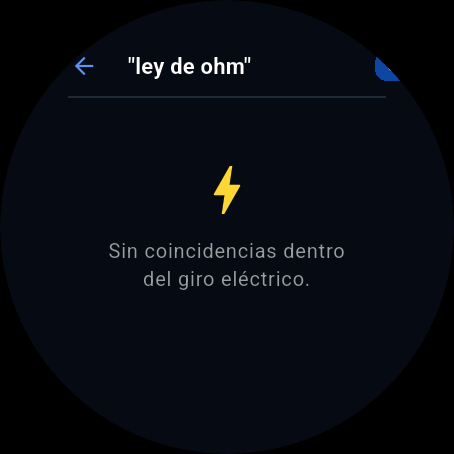

# Fase 5 — Matriz de pruebas de resiliencia y recuperación

**Componente:** aplicación móvil Wear OS (`luxraywaer`, versión optimizada) y API real de LuxRay.
**Fecha:** 11 de noviembre de 2026 · **Entorno:** emulador Wear OS API 36 (454×454 dp) + Docker Compose (12 contenedores).

---

## 5.1 Los ocho escenarios obligatorios

| Código | Escenario | Resultado esperado | Resultado obtenido | Evidencia |
|---|---|---|---|---|
| **RES-01** | Pérdida de Internet durante una consulta | Error controlado | **HTTP 0**, estado `sinConexion`, **detección en 273 ms**, 3 intentos acotados | `practica12_resiliencia_test.dart` · `evidencias/perfil_consola_despues_release.txt` |
| **RES-02** | Pérdida de Internet durante una escritura | No confirmar falsamente el registro | **HTTP 0 en 35 ms** y **0 filas** creadas en `auth_db`: la escritura **no** se confirma | `evidencias/fase5_resiliencia_api.md` |
| **RES-03** | Servidor sin respuesta | Timeout controlado | **HTTP 0**, estado `sinConexion`, **detección en 2 559 ms** (timeout de 600 ms × 3 intentos + backoff), dentro del presupuesto global | `practica12_resiliencia_test.dart` |
| **RES-04** | Respuesta HTTP 500 | Mostrar error y conservar estabilidad | Estado **`errorServidor`** (no `sinConexion`): la app no se cae y el mensaje es «El servidor no pudo responder» | `practica12_resiliencia_test.dart` |
| **RES-05** | Respuesta HTTP 401 o 403 | Gestionar correctamente autenticación o permisos | Estados **`accesoRechazado`** (401 y 403), **distintos** de `sinConexion`; mensaje propio «Sin permisos para consultar» | `practica12_resiliencia_test.dart` |
| **RES-06** | Recuperación de conexión | Restablecer la comunicación | **HTTP 200 en 274 ms** tras restaurar el enlace; en el móvil, los resultados **vuelven** sin reiniciar la app | `evidencias/fase5_resiliencia_api.md` · `evidencias/wb11_disp_recuperacion.png` |
| **RES-07** | Reintento de una escritura | Evitar duplicados inesperados | 3 intentos → **[200, 400, 400]** y **exactamente 1 fila** en `auth_db`: la restricción `UNIQUE (email)` arbitra | `evidencias/fase5_resiliencia_api.md` |
| **RES-08** | Respuesta tardía | Evitar operaciones duplicadas o inconsistentes en la interfaz | **2 564 ms** y estado `sinConexion`: el presupuesto global de 4 s corta la espera y **no** se muestra un resultado tardío como si fuera válido | `practica12_resiliencia_test.dart` |

> **Nota sobre RES-02 y RES-07.** El wearable LuxRay es una aplicación de
> **solo lectura**: su único método de red es un `GET`. Esos dos escenarios
> exigen una escritura, por lo que se ejecutan contra la **API real** a través
> de un proxy TCP con averías inyectables, verificando además el estado de
> PostgreSQL. El resto de escenarios se ejecutan contra el **cliente real**
> (`LuxrayApi`) con un servidor HTTP local que reproduce cada avería sobre
> sockets reales.

---

## 5.2 Análisis requerido

### ¿Cuánto tarda la aplicación en detectar una interrupción?

| Avería | Tiempo de detección | Mecanismo |
|---|---|---|
| Conexión cerrada de golpe (RES-01) | **273 ms** | `ECONNRESET` del socket → excepción inmediata |
| Conexión rechazada | **~35 ms** | `ECONNREFUSED` inmediato |
| Servidor que no responde (RES-03) | **2 559 ms** | Timeout de 600 ms × 3 intentos + backoff (50 + 100 ms) |
| Respuesta tardía de 3 s (RES-08) | **2 564 ms** | Presupuesto global de la operación |

**Conclusión.** La detección de una caída de red es prácticamente inmediata
(sub-segundo) porque el socket falla de forma síncrona. El peor caso es el
**timeout**, que queda acotado por el presupuesto global de la operación
(4 s en la prueba, 12 s en producción) y por el número máximo de intentos.

### ¿Qué ocurre con una operación que queda pendiente?

La operación pendiente **se cancela sola**: el `Future` de la petición
termina con `TimeoutException` y el `catch` la convierte en un estado
`sinConexion` con respuesta vacía. La UI se queda en un estado
**consistente y honesto** (mensaje «Sin conexión con el servidor»), nunca en
un spinner infinito ni en una pantalla con datos inventados.

### ¿Se repite automáticamente la solicitud?

**Sí, pero de forma acotada y sólo cuando tiene sentido:**

| Tipo de fallo | ¿Reintenta? | Motivo |
|---|---|---|
| Fallo de **transporte** (red, timeout) | **Sí**, hasta 2 reintentos (3 intentos en total) con backoff exponencial **250 ms → 500 ms** y jitter ±20 % | La petición puede no haber llegado al servidor: reintentar es seguro y puede evitar un fallo transitorio |
| **5xx** del servidor | **No** | Es una respuesta definitiva del servidor. Además, el respaldo legacy (otro servicio → PostgreSQL) es una mejor respuesta que insistir |
| **4xx** (400/401/403/404/422) | **No** | El cliente envió algo incorrecto o no tiene permisos: reintentar repetiría el mismo error |
| Fallo del respaldo legacy | **No** (1 intento) | Evita duplicar el tiempo de espera del usuario |

El presupuesto global (`timeoutTotal`, 12 s en producción) impide que la
cadena de reintentos deje al usuario esperando indefinidamente.

### ¿Puede generarse un registro duplicado?

**No**, y se ha verificado empíricamente (RES-07):

* **En la base de datos** — la restricción `UNIQUE (email)` de `usuarios`
  hace que el segundo intento del mismo correo falle con
  `duplicate key value violates unique constraint "usuarios_email_key"`.
  Medido: 3 intentos → **1 fila**.
* **En la capa de aplicación** — `AuthService.register` usa el patrón
  *check-then-act* (`existsByEmail()` y después `save()`), que **tiene**
  ventana de carrera. La restricción `UNIQUE` la cierra, pero la
  `DataIntegrityViolationException` no está mapeada y se traduciría en un
  **500** en lugar de un **409**. Es el defecto **DEF-08** de la Práctica 11,
  todavía abierto.
* **Recomendación pendiente** — cabecera `Idempotency-Key` por operación
  lógica: el servidor devolvería la respuesta original en lugar de repetir el
  efecto, y el cliente podría distinguir «ya existía» de «se acaba de crear».

### ¿Cómo se recupera el estado de la interfaz?

El estado de la interfaz se recupera **sin reiniciar la aplicación**:

1. La búsqueda fallida deja `estado = sinConexion` (o `errorServidor`).
2. El usuario puede volver al inicio y lanzar otra búsqueda: la siguiente
   petición **vuelve a intentarse** (no hay un estado terminal de error).
3. La caché **no memoiza los fallos**: un fallo de red o de servidor no queda
   cacheado, de modo que el reintento manual del usuario sale a la red.
   Verificado por la prueba «los FALLOS de red NO se memorizan».

### ¿Qué sucede si el servidor procesa la operación, pero la respuesta nunca llega al dispositivo?

Este es el caso más difícil (se denomina *unknown outcome*), y la auditoría
l en el wearable:

* El cliente ve un error de transporte y **no puede saber** si el servidor
  aplicó el efecto.
* En el wearable **no hay riesgo**, porque la app es de solo lectura: una
  consulta fallida no deja estado en el servidor.
* En una escritura, el riesgo real es el **reintento a ciegas**: el cliente
  reintenta y el servidor aplica el efecto **dos veces**. La única defensa
  con la que hoy cuenta el proyecto es la restricción `UNIQUE` de la base de
  datos (ver RES-07), que es suficiente para el alta de usuarios pero
  **no** para un endpoint sin clave única natural.
* Además, la versión optimizada incorpora **cancelación lógica**: si el
  resultado de una búsqueda llega tarde y el usuario ya lanzó otra, el
  resultado obsoleto **se descarta** y no se pinta en pantalla, con lo que la
  interfaz nunca queda desincronizada con lo que el usuario pidió.

---

## 5.3 Reto: reintento con espera progresiva e idempotencia

### Implementado: espera progresiva (exponential backoff)

```dart
Future<void> _esperaBackoff(int intento) async {
  final base = backoffBase.inMilliseconds * (1 << intento); // 250, 500, 1000...
  final jitter = (base * 0.2 * ((DateTime.now().microsecondsSinceEpoch % 1000) / 1000 - 0.5)).round();
  await Future<void>.delayed(Duration(milliseconds: (base + jitter).clamp(0, 10000)));
}
```

* **Progresiva**: 250 ms → 500 ms → 1 000 ms (×2 en cada intento).
* **Con jitter**: ±20 % para evitar que varios clientes reintenten a la vez
  (*thundering herd*) y se castiguen mutuamente al volver a caer.
* **Acotada**: máximo `reintentosMax` (2) y presupuesto global `timeoutTotal`.
* **Selectiva**: sólo ante fallos de transporte, nunca ante 4xx/5xx.

### Implementado: idempotencia en el cliente

* **Lecturas (wearable)**: la operación es idempotente por naturaleza; además
  la **caché LRU con TTL** y la **coalescencia de peticiones en vuelo**
  garantizan que dos búsquedas idénticas simultáneas compartan **una sola**
  petición HTTP (verificado: 3 llamadas concurrentes → 1 petición).
* **Escrituras (API)**: la idempotencia descansa en la clave única de la base
  de datos (`UNIQUE (email)`), verificada en RES-07.

### Propuesta pendiente (no implementada en esta práctica)

* Cabecera `Idempotency-Key` (UUID por operación lógica) en los endpoints de
  escritura, con tabla `idempotency_keys (clave, usuario, respuesta, creada_en)`
  y `UNIQUE (clave, usuario)`.
* Mapear `DataIntegrityViolationException` a **409 Conflict** (cierra el
  DEF-08 de la Práctica 11).
* Persistir el token de idempotencia **con la operación**, de modo que un
  reintento con la misma clave devuelva la respuesta original en lugar de
  repetir el efecto.
* Backoff con jitter **respecto al servidor** (`Retry-After`) cuando la
  API lo indique, en lugar del backoff local fijo.

---

## 5.4 Evidencia en el dispositivo real

Además de las pruebas automatizadas, se verificó el comportamiento en el
**wearable emulado** cortando y restaurando la conectividad del host:

| Momento | Comportamiento observado |
|---|---|
| Con red | Resultados reales («ley de ohm» → 1 curso, 1 lección) |
| **Red cortada** | La app **no se rompe** (proceso vivo, sin `FATAL` en logcat) y muestra un estado honesto |
| **Red restaurada** | Los resultados **vuelven** sin reiniciar la aplicación |




> En la versión **optimizada**, el mensaje durante el corte de red cambió de
> «Sin coincidencias dentro del giro eléctrico» a **«Sin conexión con el
> servidor. Reintenta en unos segundos.»**: el usuario ya no cree que la
> búsqueda no ha encontrado nada.
